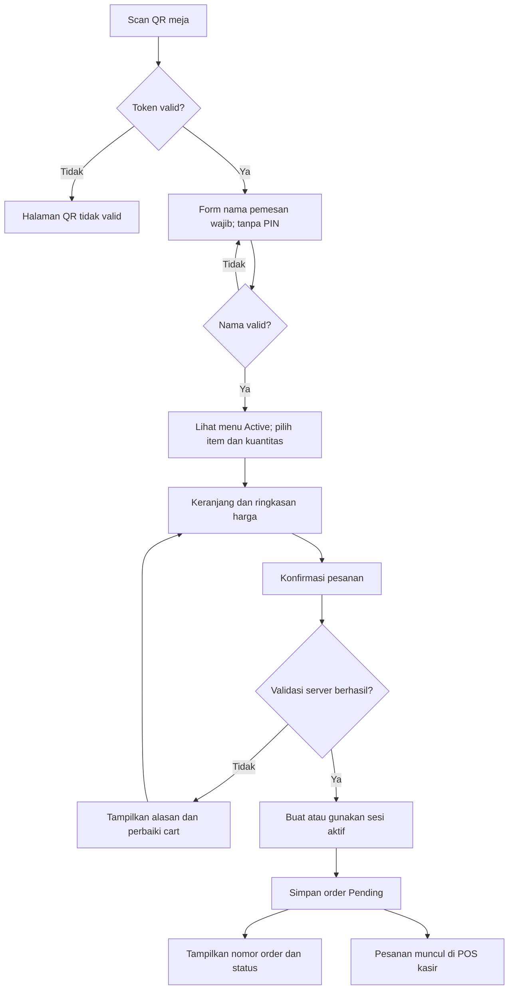
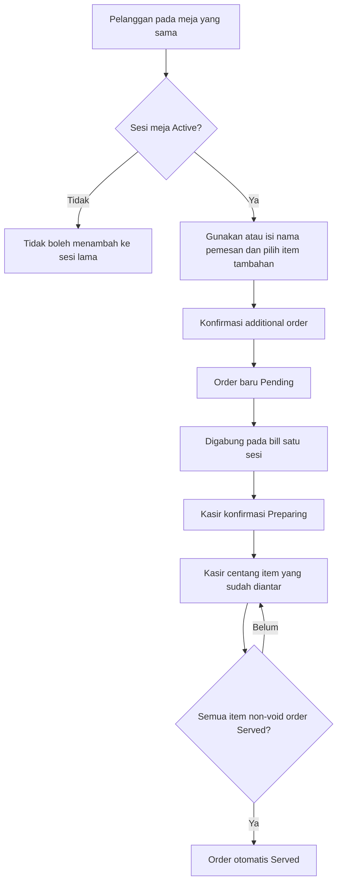
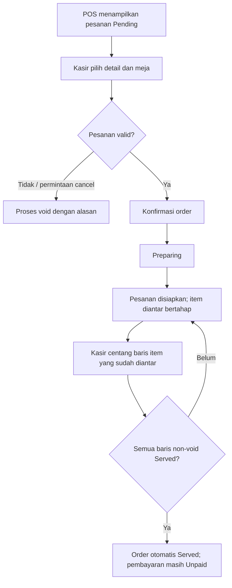
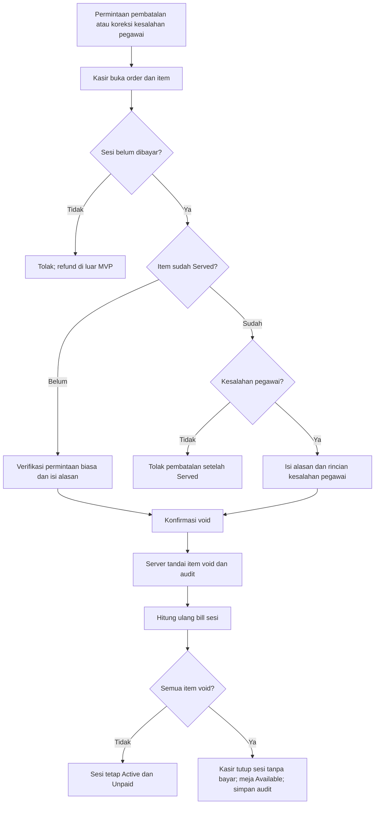
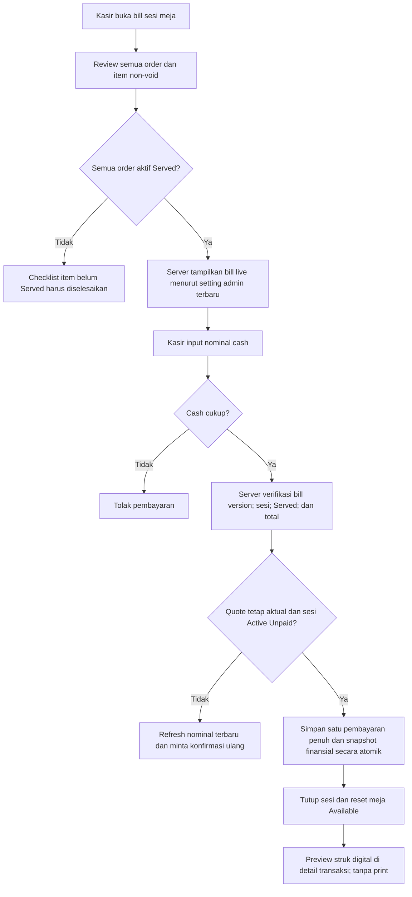
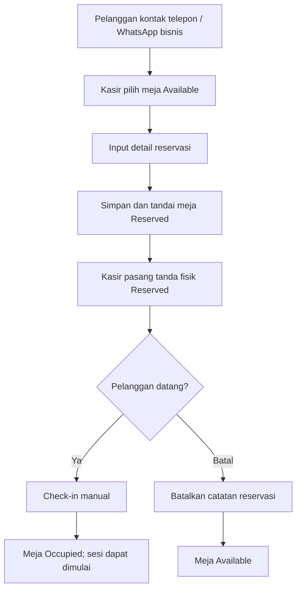

# User Flows — Restaurant POS & QR-Based Self-Ordering

| Metadata | Detail |
|---|---|
| Dokumen | `docs/03-user-flows.md` |
| Versi | 1.2 — Draft review |
| Tanggal | 10 Oktober 2026 |
| Acuan | `01-prd.md`, `02-business-rules.md` |
| Aktor | Pelanggan tanpa login, Kasir, Admin |
| Status | Siap untuk review; beberapa guard diberi label **Usulan** |

> **Keterangan:** `Pending`, `Preparing`, `Served` adalah **satu-satunya** nilai status order. *Void* tidak menambah status. `Available`, `Occupied`, `Reserved` adalah **satu-satunya** status meja. Pembayaran adalah cash penuh per sesi, tidak ada split bill. Diagram menjelaskan rancangan, bukan UI final.

---

## 1. Peta perjalanan produk

| Flow ID | Aktor | Tujuan | Hasil |
|---|---|---|---|
| UF-CUS-01 | Pelanggan | Scan QR dan mengirim order pertama | Order `Pending`, terkait meja/sesi yang benar. |
| UF-CUS-02 | Pelanggan | Menambah pesanan | Order baru pada sesi lama; bill gabungan. |
| UF-CUS-03 | Pelanggan | Memantau pesanan dan bill | Melihat status tiap order tanpa dapat membatalkan sendiri. |
| UF-CAS-01 | Kasir | Menangani order masuk | Pending → Preparing → checklist item Served → order otomatis Served. |
| UF-CAS-02 | Kasir | Memasukkan order manual | Order baru pada sesi meja. |
| UF-CAS-03 | Kasir | Membatalkan item/order | Item void, audit tersimpan, total diperbarui. |
| UF-CAS-04 | Kasir | Menerima pembayaran dan reset meja | Bayar hanya saat semua Served; satu full payment dengan snapshot; sesi Closed, meja Available. |
| UF-CAS-05 | Kasir | Membuat/mengelola reservasi | Meja Reserved, check-in, atau batal secara manual. |
| UF-ADM-01 | Admin | Mengelola menu dan QR/meja | Katalog serta token meja valid. |
| UF-ADM-02 | Admin | Mengelola pajak dan diskon | Pengaturan otomatis untuk bill sesuai aturan. |
| UF-ADM-03 | Admin | Mengelola kasir dan dashboard | Staff sesuai akses; revenue dari pembayaran lunas. |

## 2. Pelanggan: QR → order pertama (UF-CUS-01)

**Prasyarat:** QR meja dibuat admin; meja `Available` (atau sudah `Occupied` dengan sesi aktif). Menu Active tersedia. Checkout dari meja `Reserved` memerlukan check-in kasir (**usulan**).

| Langkah | Aksi/pemrosesan | Hasil yang ditampilkan / data yang berubah |
|---|---|---|
| 1 | Pelanggan memindai QR dengan token meja. | Landing pemesanan memperlihatkan nomor meja, tanpa login atau PIN. |
| 2 | Server memvalidasi token, lalu meminta **nama pemesan**. | Nama wajib diisi/valid sebelum pelanggan dapat melihat katalog; bukan bukti berada di restoran. |
| 3 | Setelah nama valid, pelanggan mencari dan menambahkan menu Active ke cart. | Nama, harga, gambar, deskripsi, kuantitas, subtotal. |
| 4 | Pelanggan membuka ringkasan dan menekan Konfirmasi Pesanan. | Klien mengirim token QR, **nama pemesan**, item, kuantitas, catatan, serta idempotency key. **Tidak** mengirim harga otoritatif. |
| 5 | Server memvalidasi ketersediaan menu, harga, status meja, dan sesi. | **Usulan:** checkout pertama pada meja Available membuka sesi Active dan mengubah meja Occupied secara atomik. |
| 6 | Server menyimpan order berstatus `Pending` bersama nama pemesan. | Order ID, nama, dan status terlihat, kasir menerima item pada antrean Pending. |
| 7 | Pelanggan mengikuti progres setelah kasir bertindak. | `Pending → Preparing → Served`; tidak ada tombol batal. |

**Failure/empty states:** QR tidak valid; meja Reserved belum check-in; item menjadi Inactive; cart kosong; sesi ditutup saat checkout; jaringan gagal; submit berulang. Untuk gagal jaringan, tampilkan opsi memeriksa status sebelum mengirim lagi agar tidak terjadi duplikasi.

**Catatan keamanan:** QR statis dan nama pemesan **tidak** memastikan pelanggan benar-benar berada di meja. Tidak ada PIN; risiko order palsu harus ditangani dengan rate limiting, token acak, antrian Pending, dan verifikasi kasir; lihat `OD-01` dan `OD-08`.

## 3. Pelanggan: additional order dan pantau status (UF-CUS-02/03)

**Aturan:** additional order **bukan** menimpa pesanan lama, melainkan record `orders` baru. Nama pemesan disimpan pada setiap order, sehingga beberapa pelanggan dari meja yang sama bisa menggunakan nama berbeda. Nama boleh diingat di browser demi kemudahan, tetapi tetap diperiksa saat checkout. Status tiap order independen.

**Contoh ilustrasi:**

| Order | Item | Status | Nilai item non-void |
|---|---|---|---:|
| ORD-001 | Nasi Goreng, Es Teh | Served | Rp65.000 |
| ORD-002 | Pisang Goreng | Preparing | Rp20.000 |
| **Sesi meja** | **Bill gabungan sebelum diskon/pajak** | **Unpaid** | **Rp85.000** |

**Privasi tanpa login:** situs dapat menampilkan status order yang diketahui browser melalui identifier/receipt token, dan subtotal meja bila sesuai desain. Jangan mengekspos nama/kontak reservasi maupun riwayat pelanggan lain secara publik. Mekanisme akses status order yang tepat masih perlu dirinci pada desain API.

## 4. Kasir: memproses antrean order (UF-CAS-01)

**Prasyarat:** kasir login, memiliki izin POS, dan pesanan QR tersimpan `Pending`.

| Langkah | Yang dilakukan kasir | Ketentuan |
|---|---|---|
| 1 | Membuka daftar order Pending dengan nomor meja, jam, dan item. | Data berasal dari server; dashboard dapat polling dan refetch. |
| 2 | Memeriksa detail dan mengonfirmasi. | Setelah konfirmasi, status **langsung `Preparing`**. |
| 3 | Mencentang item yang sudah diantar pada checklist. | Checkbox untuk satu baris berarti seluruh kuantitas baris tersaji; order otomatis `Served` jika seluruh baris non-void dicentang. |
| 4 | Bila belum bisa dipenuhi, mendiskusikan dengan pelanggan lalu melakukan void. | Tidak ada fitur cancel mandiri untuk pelanggan. |

**Guard:** order yang semua item-nya void tidak bisa menjadi Served dan dikeluarkan dari tagihan; tiap order memiliki checklist per baris. Jika ada beberapa order dalam sesi, pembayaran menunggu semuanya Served atau di-void.

## 5. Kasir: membuat order manual (UF-CAS-02)

1. Kasir membuka POS → pilih meja.
2. Sistem menampilkan sesi `Active` bila tersedia.
3. Jika `Available`, **usulan** server membuka sesi Active dan menjadikan meja `Occupied` ketika order manual disimpan.
4. Jika `Reserved`, kasir harus melakukan check-in terlebih dahulu (**usulan**).
5. Kasir memilih menu Active, kuantitas, dan catatan; sistem menghitung berdasarkan harga server.
6. Kasir menyimpan order. **Usulan:** status langsung `Preparing` karena tindakan kasir sekaligus konfirmasi.
7. Order manual bergabung dengan order QR lain dalam tagihan sesi yang sama; kasir melanjutkan ke `Served` saat selesai diantar.

**Kesalahan ditolak:** memilih meja yang tidak valid; item Inactive; mengirim kuantitas 0/negatif; mencoba membuat order pada sesi Closed secara eksplisit.

## 6. Kasir: void item/order (UF-CAS-03)

**Hasil:** baris item yang di-void tidak dihitung ke bill, tetapi tetap tersimpan dengan identitas kasir, kategori dan rincian alasan, waktu, dan nilai yang dibatalkan. Void bukan status `Cancelled`. Refund sesudah pembayaran tidak termasuk MVP.

**Sudah disepakati:** item Served hanya bisa di-void **sebagai pengecualian kesalahan pegawai sebelum Paid**, dengan alasan rinci dan audit. Pembatalan biasa setelah Served ditolak. Jika semua item void, kasir menutup sesi tanpa pembayaran, daftar aktif dibersihkan, meja Available, tetapi histori/audit tetap tersimpan. **Usulan tersisa:** pembatalan per baris item secara penuh, bukan per sebagian kuantitas.

## 7. Kasir: pelunasan penuh dan penutupan sesi (UF-CAS-04)

**Prasyarat:** ada satu sesi Active dengan tagihan valid dan **semua order non-void sudah Served**. Opsi Bayar berada pada detail sesi meja `Occupied`.

### Perhitungan ilustratif

| Komponen | Nilai |
|---|---:|
| Order awal | Rp100.000 |
| Additional order | Rp50.000 |
| Subtotal | Rp150.000 |
| Diskon global (aktif) | −Rp10.000 |
| Pajak ilustrasi 10% dari subtotal Rp150.000 | +Rp15.000 |
| **Grand total** | **Rp155.000** |
| Uang tunai diterima | Rp160.000 |
| **Kembalian** | **Rp5.000** |

**Efek sukses yang harus terjadi bersamaan:** tersimpan tepat satu pembayaran dan snapshot nilai/setting yang berlaku saat Paid; `table_sessions` Closed; `dining_tables` Available; struk memakai snapshot final. Jika satu tahap gagal, server tidak boleh meninggalkan kondisi misalnya Paid tetapi meja masih tertahan tanpa rekonsiliasi.

**Batas perubahan:** additional order, void, atau perubahan toggle/nominal pajak-diskon setelah layar bayar dibuka membuat bill version lama tidak valid. Kasir wajib melihat ulang nominal terbaru sebelum konfirmasi; bila sesi sudah Closed, order baru ke sesi lama ditolak. Gunakan transaksi/locking, bukan tombol disabled saja.

**Preview struk digital minimum:** nama toko, nomor transaksi/sesi, nomor meja, waktu bayar, **nama pemesan per order**, item dan kuantitas, harga baris, subtotal, diskon, pajak, grand total, cash diterima, kembalian, nama/ID kasir (bila ditampilkan), dan penanda LUNAS. Tampilan tersedia di detail sesi sesudah Paid atau detail riwayat transaksi kasir; **tidak ada fitur cetak/print** dan pembukaan preview ulang tidak membuat pembayaran baru.

## 8. Kasir: reservasi manual (UF-CAS-05)

**Data form minimal:** nama pelanggan, nomor kontak, jumlah tamu, meja, tanggal dan jam reservasi, serta catatan (opsional). Data kontak tidak boleh terekspos pada halaman QR publik.

**Detail operasional:** reservasi dicatat dari komunikasi di luar sistem. Setelah reservasi disimpan, kasir memberi tanda di lokasi. Sistem tidak menjadwalkan/melepas meja otomatis, tidak melakukan booking online, dan tidak menjamin ketersediaan untuk masa depan. Pada MVP, hanya meja Available dapat langsung ditandai Reserved; reservasi masa depan membutuhkan kebijakan hold manual. Meja kembali Available jika reservasi batal sebelum check-in.

**Usulan:** check-in mengubah Reserved → Occupied dan membuka sesi saat itu, atau membuat meja siap untuk pembukaan sesi pada order pertama (pilih satu dalam `OD-01`).

## 9. Admin: katalog menu dan QR meja (UF-ADM-01)

### 9.1 Menu

1. Login sebagai admin → buka `Menu Management`.
2. Tambah/edit nama, kategori, foto, deskripsi, harga; simpan.
3. Atur toggle **Active/Inactive**. Inactive tidak muncul dalam katalog pelanggan dan tidak boleh di-checkout.
4. Bila menu dijual kembali, admin mengaktifkannya tanpa mengisi stok.
5. Jika menu sudah muncul pada histori penjualan, arsipkan daripada menghapus record referensi yang memutus histori.

### 9.2 Meja & QR

1. Admin buka `Table Management`, buat meja dengan nomor unik.
2. Sistem menetapkan token QR acak dan generate file QR/template yang memuat label meja untuk dicetak.
3. Scan QR membuka halaman meja yang sesuai.
4. Pengubahan nomor meja atau regenerasi QR harus mempertahankan relasi sesi historis; penggantian token membuat QR lama tidak valid sesuai kebijakan admin.
5. Tidak boleh menghapus meja yang masih Occupied/Reserved tanpa menyelesaikan/memindahkan operasinya (rincian aksi penghapusan meja adalah guard teknis).

## 10. Admin: diskon, pajak, staff, revenue (UF-ADM-02/03)

### 10.1 Diskon dan pajak

1. Admin membuka Settings → Billing.
2. Menetapkan **nominal diskon Rupiah** dan **persentase pajak** secara terpisah. Pajak dihitung dari **subtotal sebelum diskon**; diskon nominal dipotong secara terpisah setelah subtotal didapat.
3. Menyalakan/mematikan toggle masing-masing.
4. Menyimpan pengaturan dengan versi setting terbaru; seluruh bill sesi **Unpaid** memakai konfigurasi terbaru setelah refresh/polling, tanpa perlu checkout ulang.
5. Untuk sesi `Paid`, snapshot transaksi finansial tetap dan tidak dihitung ulang. Jika kasir membuka pembayaran dengan total yang menjadi usang akibat perubahan admin, server menolak konfirmasi lama dan meminta review ulang.

### 10.2 Staf dan analitik

1. Admin membuat akun kasir atau menonaktifkan akses kasir; server menerapkan RBAC.
2. Admin membuka dashboard periode tertentu dan melihat revenue yang bersumber dari payment sukses.
3. Grafik custom dapat menampilkan pendapatan per hari, jumlah sesi lunas, dan menu terlaris; tidak menggunakan Recharts.
4. Pesanan belum lunas serta nominal uang kembalian tidak dihitung sebagai revenue.

## 11. Peta layar dan navigasi (usulan, bukan desain UI final)

| Route yang diusulkan | Aktor | Konten inti |
|---|---|---|
| `/order/[tableToken]` | Pelanggan | Validasi QR → form nama wajib → katalog, kategori, search, keranjang; tanpa login/PIN. |
| `/order/[tableToken]/cart` | Pelanggan | Cart, preview total, konfirmasi. |
| `/order/[tableToken]/status` | Pelanggan | Daftar order terkait browser/token dan statusnya. |
| `/login` | Admin/Kasir | Autentikasi staff. |
| `/pos` | Kasir | Grid meja, antrean Pending, ringkasan. |
| `/pos/tables/[tableId]` | Kasir | Detail sesi, order, manual input, void, bill. |
| `/pos/reservations` | Kasir | Form reservasi, status, check-in, pembatalan. |
| `/pos/payments/[sessionId]` | Kasir | Konfirmasi cash, kembalian, preview struk digital pasca-Paid; tanpa print. |
| `/admin` | Admin | Revenue/KPI/custom chart. |
| `/admin/menus` | Admin | CRUD/ketersediaan menu. |
| `/admin/tables` | Admin | CRUD meja dan QR templates. |
| `/admin/staff` | Admin | Akses kasir. |
| `/admin/settings` | Admin | Toggle/nilai diskon dan pajak. |

Route adalah usulan arsitektur navigasi, bukan kontrak API. Group layout Next.js dapat memisahkan pengalaman customer/cashier/admin tanpa memecah monolith.

## 12. Matriks pengecualian dan pesan UX

| Skenario | Penanganan | Pesan UI yang disarankan |
|---|---|---|
| QR invalid atau sudah diganti | Tolak, jangan redirect ke meja lain. | “QR meja tidak valid. Silakan hubungi kasir.” |
| Menu Inactive setelah ditaruh di keranjang | Tolak checkout item terkait, minta revisi. | “Salah satu menu tidak tersedia. Perbarui keranjang.” |
| Meja Reserved belum check-in | Blok checkout publik (**usulan**). | “Meja ini sedang direservasi. Hubungi kasir.” |
| Pesanan pending atau Preparing saat kasir mau bayar | Tolak pembayaran (**aturan tetap**). | “Masih ada pesanan yang belum selesai disajikan.” |
| Uang cash kurang | Jangan membuat payment. | “Nominal diterima kurang dari total tagihan.” |
| Sesi Paid pada tab kasir lain | Jangan simpan pembayaran baru. | “Tagihan meja ini sudah dilunasi.” |
| Admin mengubah pajak/diskon saat bill Unpaid terbuka | Refetch dan tampilkan nominal baru. | "Tagihan diperbarui mengikuti pengaturan toko." |
| Kasir mengonfirmasi nominal bill versi lama | Tolak, berikan perincian total baru. | "Total tagihan berubah. Periksa kembali sebelum konfirmasi pembayaran." |
| Semua item sesi telah void | Kasir menutup sesi tanpa pembayaran; hapus dari daftar aktif, bukan data histori. | "Pesanan meja dibatalkan. Meja tersedia kembali." |
| Jaringan gagal saat submit order | Cek status key/request sebelum retry. | “Koneksi terputus. Memeriksa status pesanan…” |
| Pelanggan minta cancel melalui website | Tidak ada aksi cancel; arahkan ke kasir. | “Untuk pembatalan pesanan, silakan hubungi kasir sebelum pesanan disajikan.” |
| Nama kosong setelah scan QR | Blok akses katalog sampai valid. | “Masukkan nama Anda terlebih dahulu untuk melihat menu.” |
| Kasir mencoba void item Served bukan karena kesalahan pegawai | Tolak di server. | “Pesanan sudah disajikan. Pembatalan hanya untuk koreksi kesalahan pegawai.” |
| Reservasi untuk meja tidak Available | Tolak dan tampilkan status meja terbaru. | “Meja tidak tersedia untuk reservasi.” |
| QR lama mencoba kirim ke sesi Closed | Tolak modifikasi sesi lama. | “Sesi meja sebelumnya telah selesai.” |

## 13. Swimlane naratif: satu contoh end-to-end

| Waktu | Pelanggan | Sistem | Kasir |
|---|---|---|---|
| T1 | Scan QR Meja 05, isi nama | Validasi token dan nama, baru tampil menu Active | — |
| T2 | Checkout 2 item | Sesi 05 aktif, Order #001 Pending | Muncul pesanan meja 05 |
| T3 | — | Order #001 Preparing | Konfirmasi pesanan |
| T4 | — | Order #001 Served | Mencentang semua baris item yang telah tersaji |
| T5 | Pesan minuman tambahan | Order #002 Pending, sesi tetap sama | Melihat additional order |
| T6 | — | Order #002 Preparing → Served | Konfirmasi lalu checklist Served per baris |
| T7 | Meminta tagihan dan membayar cash | Hitung bill gabungan dari setting admin **live**; verifikasi versi bill | Input cash diterima dan konfirmasi full payment saat semua order Served |
| T8 | Melihat penyelesaian transaksi | Payment tersimpan, sesi Closed, meja Available | Buka preview struk digital pada detail transaksi, siap melayani pengunjung selanjutnya |

**Yang sengaja tidak ada:** self-cancel, split bill, pembayaran digital, status Accepted/Done, table Cleaning, input stok, atau data resep.

## 14. Checklist review sebelum ERD/API

- [ ] Putuskan `OD-01` dan `OD-08`: pembukaan sesi serta mitigasi penyalahgunaan QR statis tanpa PIN.
- [x] Pajak 10% (contoh) dihitung dari subtotal sebelum diskon; nominal diskon dan pajak dari admin.
- [x] Diskon/pajak live di sesi Unpaid; snapshot dibekukan di Paid; perubahan ketika membayar harus memicu review ulang.
- [x] Semua order non-void Served sebelum full payment; checklist Served per baris item menentukan kapan order otomatis Served.
- [x] Seluruh item void memungkinkan sesi ditutup tanpa pembayaran dan meja kembali Available; histori/audit tetap ada.
- [x] Pelanggan mengisi nama sebelum katalog, tanpa PIN; void Served hanya untuk kesalahan pegawai; preview struk digital tanpa print.
- [ ] Tentukan `OD-09`: void seluruh baris item atau dapat sebagian kuantitas.
- [ ] Review race condition double checkout, extra order vs payment, dan setting toggle vs payment.
- [ ] Tentukan strategi polling/refetch sehingga perubahan setting admin dan status Served terpantau di semua layar.

**Tahap selanjutnya:** `04-system-architecture.md` dan `05-database-design.md` setelah keputusan terbuka ditetapkan.
