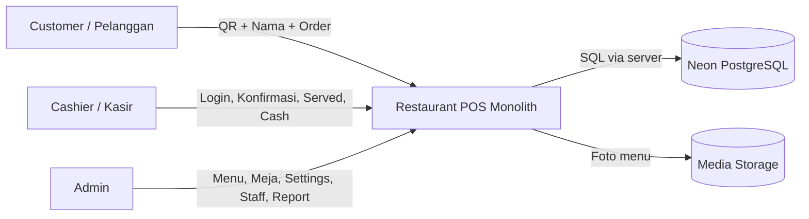
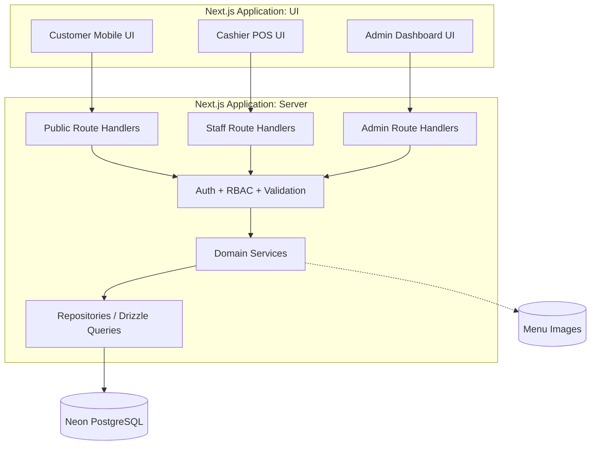
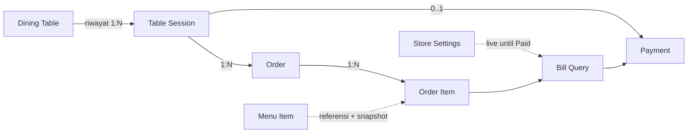
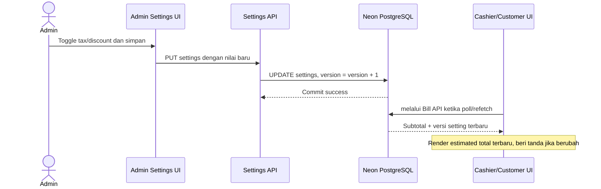
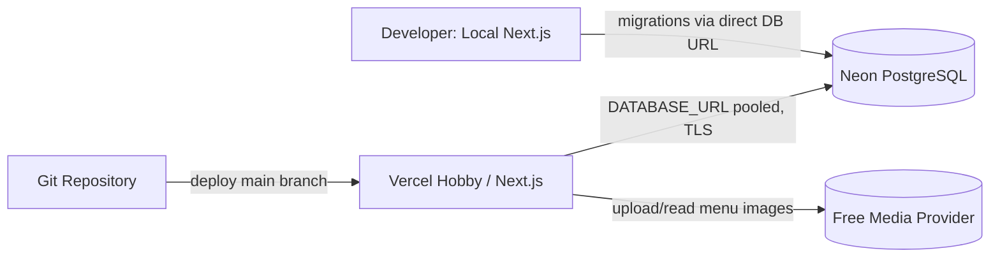

# 04 — System Architecture

## Restaurant POS & QR-Based Self-Ordering System

| Metadata | Nilai |
|---|---|
| Versi | 1.0 — Draft untuk review |
| Tanggal | 10 Oktober 2026 |
| Dokumen | `docs/04-system-architecture.md` |
| Dasar | `01-prd.md` v1.2; `02-business-rules.md` v1.2; `03-user-flows.md` v1.2 |
| Scope | Satu outlet, dine-in, QR meja statis, satu pembayaran cash penuh per sesi |
| Arsitektur | **Modular monolith**: satu aplikasi Next.js, satu database Neon PostgreSQL |
| Dokumen setelah ini | `05-database-design.md`, `06-api-specification.md` |

> **Status keputusan:** **Disepakati** adalah aturan produk yang sudah diputuskan. **Rancangan** adalah keputusan teknis yang direkomendasikan oleh dokumen ini tetapi dapat direvisi setelah review. **Terbuka** adalah kebijakan produk yang belum disahkan. Dokumen arsitektur ini tidak mengubah aturan bisnis dalam tiga dokumen sebelumnya.

---

## 1. Ringkasan keputusan arsitektur

Sistem adalah aplikasi web *modular monolith*: halaman pelanggan, aplikasi kasir, dashboard admin, route API, service domain, dan akses database berada dalam **satu codebase dan satu deployment aplikasi**. Database dikelola Neon PostgreSQL dan gambar menu ditempatkan di penyimpanan media terpisah.

### 1.1 Keputusan produk yang mengikat

1. **Satu outlet dan tiga aktor:** Admin dan Kasir dengan login; Pelanggan tanpa login, memasukkan **nama** setelah scan QR sebelum membuka menu.
2. **Satu QR unik per meja**, bukan QRIS. Nama bukan autentikasi atau bukti keberadaan fisik.
3. **Satu meja hanya boleh punya satu sesi aktif**; pesanan awal dan additional order bergabung dalam satu tagihan.
4. **Status order hanya** `Pending → Preparing → Served`; checklist Served dilakukan **per baris item** oleh kasir. Order menjadi `Served` otomatis setelah semua item non-void dicentang.
5. **Status meja hanya** `Available`, `Occupied`, `Reserved`; sesi memiliki status internal `Active`/`Closed` yang berbeda dari status meja.
6. **Pembatalan hanya oleh kasir** sebelum pembayaran; item Served boleh di-void **hanya karena kesalahan pegawai**, dengan alasan dan audit.
7. **Tidak ada split bill, cicilan, atau gateway:** satu pembayaran tunai penuh per sesi ketika **seluruh order aktif non-void telah Served**. Konfirmasi pembayaran menutup sesi dan mengubah meja ke `Available` secara atomik.
8. **Bila seluruh item di-void**, kasir boleh menutup sesi tanpa pembayaran; data hilang dari tampilan aktif, tetapi riwayat dan audit disimpan (bukan hard delete).
9. **Diskon nominal dan pajak persentase** diaktifkan admin secara terpisah; keduanya dihitung sekali terhadap subtotal sesi. `total = subtotal - min(diskon, subtotal) + round(subtotal × tarif_pajak)`; pajak memakai subtotal **sebelum diskon**.
10. **Live before payment, frozen after payment:** konfigurasi terbaru memengaruhi sesi belum lunas; setelah Paid, snapshot tagihan/struk tidak boleh berubah.
11. Menu memiliki toggle `is_available`, tanpa stok, resep, dan ingredients. Tidak ada pencetakan struk; hanya **preview digital**.
12. Reservasi dicatat dan ditandai manual oleh kasir, tanpa booking online atau penjadwalan otomatis.

### 1.2 Technology Decision Record (rancangan teknis)

| Lapisan | Pilihan baseline | Alasan / catatan |
|---|---|---|
| UI + backend | **Next.js App Router + TypeScript** | Satu aplikasi untuk tiga pengalaman dan API, sesuai monolith. |
| Styling | Tailwind CSS + shadcn/ui | Komponen konsisten; customer mobile-first, POS tablet/desktop. |
| Forms / validasi | React Hook Form + Zod | Validasi UI dan kontrak input server; backend tetap sumber validasi final. |
| Database | **Neon PostgreSQL** | Transaksi ACID, constraint, indeks, dan riwayat transaksi. |
| ORM / migrations | **Drizzle ORM + Drizzle Kit** | Relasi SQL eksplisit, skema dan migrasi berbasis kode. |
| Koneksi transaksi | **Node.js runtime + `pg` (node-postgres) + Drizzle** | Cocok untuk transaksi interaktif dan `SELECT ... FOR UPDATE`; gunakan pooled URL Neon untuk aplikasi. |
| Staff authentication | Better Auth (usulan) | Session login Admin/Kasir; RBAC tetap diverifikasi pada business service. |
| Pembaruan UI | TanStack Query dengan polling (usulan) | Tanpa infrastruktur push khusus untuk MVP; target 3–5 detik di POS. |
| Grafik | Custom React + SVG | Tidak menggunakan Recharts; sumber data tetap API/report query. |
| QR | Paket `qrcode` | Gambar QR memuat tautan publik berbasis token acak meja. |
| Foto menu | Cloudinary Free atau provider media gratis setara (usulan) | Simpan URL/metadata di PostgreSQL, bukan blob foto dalam tabel menu. |
| Deploy demo | Vercel Hobby + Neon Free (usulan) | Evaluasi batas dan syarat paket gratis sebelum deploy; penggunaan demo personal nonkomersial. |
| Test | Vitest, Testing Library, Playwright | Unit, integration, E2E; integration DB pada database pengujian terpisah. |

**Mengapa memilih `pg`, bukan `neon-http`, untuk semua transaksi mutasi?** Operasi seperti pembayaran memerlukan locking, pemeriksaan ulang, dan beberapa perintah dalam **satu transaksi interaktif**. Dokumentasi Drizzle membedakan Neon HTTP untuk query/single non-interactive transaction dan driver koneksi untuk interactive transaction. Pilihan `pg` + Node.js memudahkan pola locking standar PostgreSQL pada MVP.

Referensi teknis: [Next.js Route Handlers](https://nextjs.org/docs/app/getting-started/route-handlers), [Drizzle + Neon](https://orm.drizzle.team/docs/connect-neon), [Neon connection/pooling](https://neon.com/docs/connect/connection-pooling).

---

## 2. C4 — System Context



- **Customer:** tidak mengakses database atau endpoint staff secara langsung; hanya endpoint publik dengan token meja.
- **Kasir:** mengelola order, meja, check-in reservasi, void, pembayaran, dan preview transaksi.
- **Admin:** mengelola konfigurasi global, menu, meja/QR, akun kasir, laporan revenue.
- **Neon:** satu sumber kebenaran seluruh state bisnis dan nilai finansial. Media Storage hanya menyimpan file gambar; metadata ada di Neon.

## 3. Container Architecture / Logical Layers



**Arah ketergantungan:** `UI → HTTP handler → auth/validation → domain service → repository/transaction → database`. Route handler tidak boleh berisi logika keuangan kompleks; UI tidak boleh menentukan nilai final transaksi. Business services tidak boleh membaca state langsung dari komponen React.

**Modular monolith ≠ microservices.** Modul dipisah berdasarkan domain dan aturan import, tetapi tidak memiliki proses, message broker, atau database terpisah.

## 4. Modul/domain dan tanggung jawab

| Modul | Tanggung jawab utama | Yang **tidak** boleh dilakukan |
|---|---|---|
| `auth` | Login staff, session, role `admin/cashier` | Menganggap nama pelanggan sebagai akun. |
| `tables` | Identitas meja, QR token, state dan lock meja | Membuat pembayaran langsung. |
| `table-sessions` | Sesi aktif, membuka/menutup sesi, revisi state | Menghapus histori ketika meja direset. |
| `menu` | Kategori, CRUD menu, ketersediaan, metadata gambar | Menyimpan stok/resep. |
| `orders` | Checkout publik, additional order, input manual, konfirmasi, checklist Served, void | Mempercayai harga dari browser. |
| `billing` | Kalkulasi tagihan sesi, versi quote, diskon/pajak yang berlaku | Mengubah snapshot Paid. |
| `payments` | Validasi Served, cash, transaksi, snapshot, tutup sesi | Menerima pembayaran sebagian atau membayar order individual. |
| `reservations` | Pencatatan reservasi manual dan check-in | Auto-booking/auto-expiration. |
| `settings` | Pengaturan outlet dan toggle diskon/pajak; versi global | Mengedit riwayat Paid. |
| `reports` | Revenue Paid, volume transaksi, menu terlaris, data chart custom | Menghitung revenue dari order belum dibayar. |
| `audit` | Event actor/waktu/alasan/konteks operasi kritis | Mengizinkan penulisan audit bebas oleh pelanggan. |

### 4.1 Kontrak lintas modul

- `orders` mengubah sesi **melalui** service sesi yang memiliki aturan locking, bukan dengan update `table_sessions` acak dari UI.
- `billing` mengekspos **pure function** untuk perhitungan tagihan dan fungsi query untuk mengambil item non-void + konfigurasi aktif.
- `payments` merupakan pemilik *orchestration* penutupan sesi: ia menggunakan `billing`, `table-sessions`, dan `audit` dalam **satu transaction context**.
- `reports` membaca data penjualan historis dan tidak memodifikasi status operasional.
- Semua modul menggunakan definisi tipe domain/enum tunggal, bukan menyalin enum di tiap halaman.

## 5. Struktur repository yang direkomendasikan

```text
restaurant-pos/
├── docs/
│   ├── 01-prd.md
│   ├── 02-business-rules.md
│   ├── 03-user-flows.md
│   ├── 04-system-architecture.md
│   ├── 05-database-design.md
│   └── 06-api-specification.md
├── src/
│   ├── app/
│   │   ├── (auth)/login/page.tsx
│   │   ├── (customer)/order/[tableToken]/page.tsx
│   │   ├── (cashier)/pos/page.tsx
│   │   ├── (cashier)/pos/tables/[tableId]/page.tsx
│   │   ├── (cashier)/pos/transactions/[paymentId]/page.tsx
│   │   ├── (admin)/admin/page.tsx
│   │   ├── (admin)/admin/menus/page.tsx
│   │   ├── (admin)/admin/tables/page.tsx
│   │   ├── (admin)/admin/settings/page.tsx
│   │   └── api/
│   │       ├── public/...
│   │       ├── staff/...
│   │       └── admin/...
│   ├── features/
│   │   ├── auth/
│   │   ├── tables/
│   │   ├── table-sessions/
│   │   ├── menu/
│   │   ├── orders/
│   │   ├── billing/
│   │   ├── payments/
│   │   ├── reservations/
│   │   ├── settings/
│   │   ├── reports/
│   │   └── audit/
│   ├── components/
│   │   ├── ui/
│   │   ├── shared/
│   │   └── charts/         # custom SVG charts
│   ├── db/
│   │   ├── schema/
│   │   ├── migrations/
│   │   ├── client.ts
│   │   └── transaction.ts
│   ├── lib/
│   │   ├── auth.ts
│   │   ├── permissions.ts
│   │   ├── errors.ts
│   │   └── result.ts
│   └── types/
├── tests/
│   ├── unit/
│   ├── integration/
│   └── e2e/
├── drizzle.config.ts
├── next.config.ts
├── package.json
└── .env.example
```

Setiap `features/<domain>/` boleh memiliki `components/`, `schemas.ts`, `service.ts`, `repository.ts`, `types.ts`, dan `__tests__/`. Komponen UI dipakai bersama jika memang reusable, tanpa menduplikasi service atau aturan akses per role. Gunakan `server-only` pada service/repository yang menyentuh database atau secret. **Folder `app/` adalah route composition, bukan tempat menumpuk business logic.**

## 6. Public routes, staff routes, dan boundary kepercayaan

### 6.1 Routes halaman (rancangan)

| URL | Aktor | Tujuan |
|---|---|---|
| `/order/[tableToken]` | Publik | QR → form nama → katalog → cart → status order |
| `/login` | Staff | Login |
| `/pos` | Kasir/Admin | Overview meja dan order masuk |
| `/pos/tables/[tableId]` | Kasir/Admin | Order/checklist/bill/payment meja |
| `/pos/reservations` | Kasir/Admin | Reservasi manual |
| `/pos/transactions/[paymentId]` | Kasir/Admin | Preview struk digital dari Paid snapshot |
| `/admin` | Admin | Ringkasan revenue |
| `/admin/menus` | Admin | CRUD dan availability |
| `/admin/tables` | Admin | Manajemen meja dan QR |
| `/admin/staff` | Admin | Akun kasir |
| `/admin/settings` | Admin | Tax/discount live |

### 6.2 API surface konseptual (detail ada di dokumen 06)

| Endpoint contoh | Role | Proses |
|---|---|---|
| `GET /api/public/tables/:token/menu` | Publik | Validasi token, metadata meja, menu available |
| `POST /api/public/tables/:token/orders` | Publik | Nama, item, request idempotent; buat/join sesi aktif dan order Pending |
| `GET /api/public/tables/:token/session` | Publik | Status order + estimasi bill, **hanya data non-sensitif** |
| `GET /api/staff/orders?status=Pending` | Kasir/Admin | Inbox pesanan |
| `POST /api/staff/orders/:id/confirm` | Kasir/Admin | Pending → Preparing |
| `PATCH /api/staff/order-items/:id/served` | Kasir/Admin | Checklist satu baris, otomatis hitung order Served |
| `POST /api/staff/order-items/:id/void` | Kasir/Admin | Void + reason/audit |
| `GET /api/staff/table-sessions/:id/bill` | Kasir/Admin | Quote total + versi |
| `POST /api/staff/table-sessions/:id/payments` | Kasir/Admin | Cash penuh, versi quote, lock+snapshot, tutup sesi |
| `POST /api/staff/table-sessions/:id/close-void` | Kasir/Admin | Tutup sesi tanpa bayar jika semua item void |
| `POST /api/staff/reservations` | Kasir/Admin | Reservasi manual |
| `PUT /api/admin/settings/billing` | Admin | Perubahan tax/diskon dan increment versi |
| `PATCH /api/admin/menus/:id/availability` | Admin | On/off menu |
| `GET /api/admin/reports/revenue` | Admin | Revenue Paid untuk custom charts |

Contoh di atas **bukan kontrak request/response final**, hanya domain API yang harus tersedia. Endpoint publik tidak mengirim data staf, nomor kontak reservasi, audit, atau rincian finansial historis sesi lain.

## 7. Model state dan invariant (input untuk ERD)



**Invariant database:**

- `table_sessions`: maksimal **satu row Active per `table_id`** (partial unique index); setiap meja `Occupied` harus terkait satu sesi Active, termasuk setelah check-in reservasi.
- `payments`: `session_id` unik; hanya untuk sesi yang berhasil dibayar penuh; lakukan operasi dengan transaction.
- `order_items`: memiliki snapshot `menu_name`, `unit_price`, `quantity`, `served_at`, `voided_at`, dan alasan/aktor void yang relevan.
- `orders.status` tepat `Pending|Preparing|Served`; void item/order adalah metadata terpisah, tidak menambah enum pelayanan.
- `dining_tables.status` tepat `Available|Occupied|Reserved`, tanpa `Cleaning`.
- `store_settings`: satu record outlet dengan `discount_enabled`, `discount_amount`, `tax_enabled`, `tax_rate`, dan `version` integer yang meningkat setiap perubahan.
- `table_sessions`: punya `revision` yang meningkat saat order dibuat, item di-void, checklist Served berubah, dan operasi relevan lain.
- `payments`: menyimpan snapshot `subtotal`, `discount_enabled`, `discount_amount_applied`, `tax_enabled`, `tax_rate`, `tax_amount`, `grand_total`, `cash_received`, `change_amount`, `paid_at`, `cashier_id`, serta versi quote. Detail item historis diambil dari snapshot order item yang tidak dapat dimodifikasi setelah Paid, atau dari receipt snapshot jika diimplementasikan.
- Seluruh nominal Rupiah memakai integer/`bigint` yang aman di backend; jangan floating point untuk uang. Tarif pajak dapat memakai tipe `numeric` di database atau basis points integer agar kalkulasi presisi.

## 8. Alur teknis kritis (sequence diagrams)

### 8.1 QR → nama → pesanan pertama / tambahan

```mermaid
sequenceDiagram
    actor C as Customer
    participant UI as Customer UI
    participant API as Public Order API
    participant S as Order/Session Service
    participant DB as Neon PostgreSQL
    C->>UI: Scan QR, isi nama, pilih menu
    UI->>API: POST order + idempotency key
    API->>S: Validasi token, nama, menu, quantities
    S->>DB: BEGIN; lock table; locate active session
    alt Ada sesi Active
       S->>DB: Join sesi; insert order Pending/items snapshot
    else Table Available dan belum ada sesi
       S->>DB: Create session Active; table Occupied; insert Pending order
    else Table Reserved / tidak valid
       S-->>API: Reject (check-in kasir diperlukan jika Reserved)
    end
    S->>DB: Increment session revision; COMMIT
    API-->>UI: Order ID + status Pending
    Note over DB: Partial unique index prevents 2 active sessions per table
```

**Status:** Pembukaan sesi otomatis pada checkout pertama meja `Available` adalah **rancangan/usulan OD-01**, belum final. Alternatif manual activation oleh kasir akan mengganti satu tahap ini, tidak mengubah model transaksi inti. Checkout dari meja `Reserved` diblokir sampai check-in (usulan OD-08/BR-17). QR statis tetap bisa disalahgunakan; verifikasi kasir sebelum `Preparing` adalah mitigasi, bukan bukti lokasi pelanggan.

### 8.2 Pending → Preparing → Served + void

1. Kasir melihat daftar order baru melalui polling dan mengonfirmasi order → `Preparing`.
2. Checklist satu baris `order_item` dapat ditandai Served setelah **seluruh kuantitas baris** disajikan. Setelah semua baris non-void Served, service menaikkan status parent order menjadi `Served`.
3. Selama Unpaid, kasir dapat void item. Jika item sudah Served, server hanya menerima alasan kategori `employee_error`, mencatat detail alasan dan audit. Setelah Paid, perubahan item ditolak.
4. Bila semua item pada suatu order di-void, order tidak lagi ikut bill/progress aktif; status pelayanan terakhir tidak diubah menjadi `Cancelled`.
5. Bila seluruh sesi menjadi kosong karena void, **kasir** menutup sesi tanpa payment dan meja kembali Available dalam transaksi DB. Event audit dipertahankan.

### 8.3 Tagihan live ketika Admin mengganti pajak/diskon



> Diagram memendekkan satu lapisan: pada implementasi sebenarnya **POS memanggil Bill API**, bukan Neon langsung. Hanya backend yang boleh mengakses database.

**Billing algorithm (pure function / server):**

```ts
// Pseudocode domain, bukan implementasi final.
subtotal = sum(nonVoidItems.map(item => item.quantity * item.unitPriceSnapshot))
discountApplied = settings.discountEnabled
  ? min(settings.discountAmount, subtotal)
  : 0
taxAmount = settings.taxEnabled
  ? roundRupiah(subtotal * settings.taxRate / 100) // based on ORIGINAL subtotal
  : 0
grandTotal = subtotal - discountApplied + taxAmount
```

Perhitungan menggunakan decimal/basis-point-safe arithmetic dengan kebijakan pembulatan Rupiah yang konsisten di server. Client tidak boleh mengirim total untuk dipercaya.

**Versi quote (rancangan):** respons bill membawa `session_revision` + `settings_version` + `grand_total` + `calculated_at`. Angka diperlakukan sebagai *expected version* oleh client. Setiap additional order, checklist, void, atau setting berubah, expected version lama tidak lagi valid. Harga order yang sudah dibuat tetap snapshot.

### 8.4 Cash payment → closing → table Available (paling kritis)

```mermaid
sequenceDiagram
    actor K as Cashier
    participant UI as POS UI
    participant API as Payment API
    participant DB as Neon PostgreSQL
    K->>UI: Open table detail and bill quote
    UI->>API: POST payment (cash + expected revisions + request id)
    API->>DB: BEGIN, lock settings/table/session consistently
    API->>DB: Verify Active + all nonvoid orders Served
    API->>DB: Recalculate bill + compare expected revisions
    alt Quote changed
        API->>DB: ROLLBACK
        API-->>UI: 409 BILL_CHANGED + latest quote
        UI-->>K: Review new amount, confirm again
    else Valid and full cash received
        API->>DB: INSERT one payment with frozen snapshot
        API->>DB: UPDATE session Closed; table Available; audit event
        API->>DB: COMMIT
        API-->>UI: Payment ID + digital receipt preview
    end
```

**Aturan transaksi:**

- Ambil lock secara konsisten: setiap operasi terkait meja/sesi mengunci baris **table lebih dulu kemudian session**. Pada pembayaran, baca/lock row settings sebelum table/session agar perubahan settings terserialisasi dengan pembayaran. Admin update settings hanya menyentuh row settings. Urutan ini ditetapkan bersama saat implementasi seluruh service untuk menghindari deadlock.
- Semua operasi yang menambah order/void/checklist/menutup sesi mengunci sesi bersangkutan. Checkout pertama mengunci table sebelum membuat session; hanya satu Active session boleh ada di database.
- API **menghitung ulang subtotal dan settings setelah memperoleh lock**. UI harus mengirim versi yang dilihat; jika versi tidak cocok, server memberikan respons conflict dan bill terbaru. Cash yang diinput **tidak** otomatis diterima terhadap total baru tanpa review kasir.
- Periksa `all_non_void_orders_served = true` dan total item non-void > 0; jika semuanya void, gunakan endpoint penutupan tanpa pembayaran.
- Pastikan pembayaran berjumlah **tepat satu row sukses per session**, dengan unique constraint + idempotency key dan proses retry yang aman.
- Jika timeout jaringan setelah commit, UI membaca ulang status session/payment sebelum mengulang; jangan menganggap request gagal berarti pembayaran belum berhasil.
- Setelah Closed, setiap endpoint modifikasi order/item/sesi lama **wajib ditolak**, bahkan apabila browser pelanggan menyimpan URL lama. Request dari tab pelanggan lama harus membawa konteks sesi yang sedang dilihat (bila sudah ada); jangan diam-diam membuka sesi baru dari tab lama setelah meja direset. Hal ini mengurangi order tidak disengaja tetapi tidak menghilangkan risiko QR statis difoto.

### 8.5 Reservasi manual

1. Kasir menerima permintaan melalui nomor bisnis **di luar aplikasi**.
2. Kasir memilih meja Available, mengisi identitas/kontak, jumlah orang, waktu, dan catatan; service memvalidasi bahwa meja belum Occupied/Reserved lalu menyimpan reservasi + status Reserved secara atomik.
3. Kasir memasang tanda fisik `Reserved` pada meja.
4. Saat pelanggan datang, kasir melakukan check-in: meja menjadi `Occupied` **dan sesi Active dibuat secara atomik**. Dengan demikian tidak ada keadaan `Occupied` tanpa sesi aktif. Ini berlaku khusus check-in reservasi; mekanisme sesi dari meja `Available` tetap mengikuti OD-01.
5. Saat batal, data reservasi ditandai batal dan status meja kembali Available jika belum Occupied.

## 9. Polling, cache, dan konsistensi UI

| Halaman | Pemutakhiran MVP (usulan) | Catatan |
|---|---|---|
| POS inbox pesanan | Poll setiap 3–5 detik + focus refetch | Tampilkan waktu update terakhir; snackbar untuk order Pending baru. |
| Detail meja/order | Poll setiap 3–5 detik saat aktif; refetch setelah mutate | UI optimis **tidak** digunakan untuk mencatat pembayaran. |
| Customer status pesanan | Poll 5–10 detik ketika halaman terbuka | Jangan bocorkan rincian sesi lain. |
| Admin financial settings preview | Refetch/invalidate setelah Save | POS mendapat versi setting baru pada polling berikutnya. |
| Revenue charts | Refetch periodik ringan atau setelah filter | Tidak perlu interval agresif; custom SVG hanya visualisasi. |

- Domain dinamis `orders`, `sessions`, `bill`, dan `payments` **tidak** boleh mengandalkan HTML/API cache yang dapat menyajikan data lintas pengguna atau versi usang.
- TanStack Query adalah cache **client**; Neon adalah sumber kebenaran. Invalidate queries pasca-mutasi dan saat tab fokus lagi.
- Terminologi: **near-real-time** dengan polling, bukan push realtime WebSocket.
- Jika nanti traffic tinggi, barulah evaluasi push atau event-based architecture. Vercel saat ini mendukung WebSocket dalam function dengan batas durasi/keterbatasan state lintas instance; untuk MVP tidak diperlukan.

## 10. Keamanan dan privacy-by-design

### 10.1 Authentication / authorization

- Admin dan kasir menggunakan login/session berbasis cookie yang aman (HttpOnly, Secure ketika HTTPS, SameSite yang sesuai), dan pengujian akses per role.
- **RBAC di server setiap mutasi/query staff.** Proteksi route layout tidak menggantikan pemeriksaan di service/API.
- Customer tidak membuat akun; nama form tidak boleh digunakan untuk mengotorisasi akses khusus.
- Secret (DB URL, auth secret, credential media provider) hanya tersimpan server-side. Jangan gunakan awalan `NEXT_PUBLIC_` untuk secret.
- Endpoint mutasi staff wajib memeriksa CSRF/cross-origin sesuai mekanisme session/auth yang dipakai; jangan percaya `role` yang dikirim frontend.

### 10.2 Risiko QR statis tanpa PIN — residual risk

- Token QR sulit ditebak (random, cukup panjang); hindari urutan angka meja sebagai satu-satunya identifier publik.
- **QR token adalah locator, bukan proof-of-presence**; seseorang yang memfoto QR masih dapat mengaksesnya di luar restoran. Setelah sesi ditutup, browser lama yang membawa session ID tertutup tidak boleh otomatis membuat sesi baru; minta pelanggan memulai ulang flow.
- Terapkan rate limit endpoint publik (IP/token dan pembuatan order); gunakan penyimpanan shared atau mekanisme platform, **bukan hanya counter in-memory proses** pada deployment multi-instance.
- Kasir selalu memverifikasi order Pending sebelum menjadi Preparing; sediakan UI untuk void/tutup sesi order palsu.
- Jangan masukkan nomor kontak pelanggan reservasi, audit staff, dan data administratif ke respons public API.
- Jika risiko QR tetap tinggi pada pemakaian nyata, perlu membahas aktivasi sesi manual atau rotasi token; **tidak menambahkan PIN ke MVP** tanpa keputusan user.

### 10.3 Validasi dan audit

- Zod untuk validasi bentuk request; service untuk validasi business rule; database constraint untuk invariant terakhir.
- Simpan alasan + aktor + waktu pada void, perubahan settings, pembayaran, penutupan tanpa tagihan, dan tindakan sensitif.
- Jangan menampilkan stack trace/SQL error ke pelanggan.
- Simpan nomor kontak reservasi seminimal mungkin dan lindungi akses hanya untuk staff.

## 11. Operasional/deployment gratis



### 11.1 Environment variables (contoh nama, **tanpa nilai asli**)

```dotenv
DATABASE_URL=postgresql://<user>:<password>@<neon-pooler-host>/<db>?sslmode=require
DATABASE_URL_DIRECT=postgresql://<user>:<password>@<neon-direct-host>/<db>?sslmode=require
BETTER_AUTH_SECRET=<server-side-secret>
BETTER_AUTH_URL=http://localhost:3000
NEXT_PUBLIC_APP_URL=http://localhost:3000
# Jika memilih external image provider:
CLOUDINARY_CLOUD_NAME=<cloud-name>
CLOUDINARY_API_KEY=<server-side-key>
CLOUDINARY_API_SECRET=<server-side-secret>
```

Nilai di atas adalah placeholder, jangan dicopy sebagai credential nyata. Gunakan **pooled connection** untuk proses web dan **direct** untuk operasi migration/administrasi bila dibutuhkan tool; tetap sesuaikan dokumentasi driver/provider yang dipakai saat setup.

### 11.2 Strategi lingkungan

- **Local:** Next.js dev + Neon `production` yang ter-link berisi data fiktif untuk pengembangan/demo; seed data menu/meja/staff demo.
- **Migrasi:** review dan backup sebelum mengubah schema pada Neon yang ter-link; jangan jalankan migrasi destructive otomatis.
- **Demo production:** HTTPS, secret diset via platform environment, login staff demo terbatas, data dummy, audit/error monitoring dasar.
- **Free plan:** kuota/batas layanan dapat berubah. Desain menghindari kebutuhan Redis, queue, realtime broker, dan layanan berbayar untuk MVP.
- **Backup:** ekspor data/backup sesuai kemampuan plan; jangan menganggap free-tier memiliki SLA/retensi backup produksi.

## 12. Error model dan kontrak respons standar

Respons API harus konsisten, misalnya:

```json
{
  "error": {
    "code": "BILL_CHANGED",
    "message": "Tagihan berubah. Periksa nominal terbaru sebelum membayar.",
    "details": { "latestQuoteAvailable": true }
  }
}
```

| Code contoh | HTTP | Kapan |
|---|---:|---|
| `INVALID_TABLE_TOKEN` | 404 | QR token tidak dikenali. |
| `TABLE_RESERVED` | 409 | Meja belum check-in. |
| `MENU_UNAVAILABLE` | 409 | Menu dinonaktifkan setelah cart dibuat. |
| `DUPLICATE_REQUEST` | 409 / 200 replay | Request dengan idempotency yang tidak cocok atau replay. |
| `INVALID_ORDER_TRANSITION` | 409 | Melompati state pelayanan. |
| `ITEM_ALREADY_SERVED` | 409 | Void biasa pada item Served. |
| `SESSION_NOT_ACTIVE` | 409 | Checkout terhadap sesi sudah Closed. |
| `NOT_ALL_ITEMS_SERVED` | 409 | Payment sebelum semua Served. |
| `BILL_CHANGED` | 409 | Revisi sesi/settings berubah. |
| `CASH_INSUFFICIENT` | 422 | Uang tunai kurang. |
| `PAYMENT_ALREADY_RECORDED` | 409 / 200 replay | Sesi sudah dibayar. |
| `FORBIDDEN` | 403 | Hak akses tidak sesuai. |

API harus mengembalikan status terbaru yang boleh ditampilkan pengguna ketika terjadi conflict. **Jangan memproses retry otomatis untuk payment dengan nominal yang berubah.**

## 13. Testing architecture

| Jenis | Kasus wajib |
|---|---|
| Unit — Billing | Diskon sekali per sesi, pajak dari subtotal sebelum diskon, cap discount, tax toggle live, rounding. |
| Unit — State machine | Pending→Preparing; checklist→Served; Served void employee error only; table status tiga nilai. |
| Integration — DB | Dua checkout serentak membuat satu sesi; idempotency; transaksi payment atomic; partial unique index. |
| Integration — Concurrency | Payment vs additional order; payment vs settings update; payment vs void; dua kasir bayar bersamaan. |
| Integration — RBAC | Kasir tidak boleh mengganti tax; publik tidak bisa mengubah status/void/payment. |
| E2E | Scan QR→isi nama→order→konfirmasi kasir→checklist Served→additional order→bayar cash→preview struk→Available. |
| E2E | Semua item void→close without payment→Available, revenue tidak bertambah. |
| E2E | Admin mengaktifkan pajak ketika sesi Unpaid→bill berubah→payment simpan snapshot→matikan pajak→receipt tidak berubah. |

Gunakan **database test terpisah**. Jangan memakai database demo yang memiliki transaksi penting ketika menjalankan test mutation/rollback.

## 14. Observability & performa

- Log server terstruktur mencantumkan `requestId`, operasi, actor staff (jika ada), `tableId`, `sessionId` (jika sah), hasil, dan durasi; **jangan log credential, nama pelanggan/nomor kontak secara berlebihan**, atau isi cookie.
- Audit khusus aksi sensitif disimpan di tabel audit secara persisten.
- Indeks pada `orders(session_id, created_at)`, `orders(status, created_at)`, `order_items(order_id)`, `table_sessions(table_id, status)`, `payments(paid_at)`, dan FK terkait ditetapkan di ERD.
- Halaman menu memuat gambar teroptimasi; pagination/filter untuk daftar histori; query report difilter periode dan status Paid.
- Hindari polling latar belakang ketika tab tidak aktif untuk mengurangi kuota gratis; lakukan refetch ketika kembali fokus.
- Tidak ada target skala restoran besar dalam MVP; ukur performa query dari dataset dummy realistis sebelum optimasi prematur.

## 15. Architecture Decision Records (ringkas)

| ID | Keputusan | Status | Trade-off |
|---|---|---|---|
| ADR-001 | Modular monolith Next.js | Rancangan disarankan | Sederhana deploy, satu runtime; scaling per fitur belum terpisah. |
| ADR-002 | Neon PostgreSQL | **Disepakati** | Konsistensi relational; ada kuota dan latensi jaringan. |
| ADR-003 | Drizzle + `pg` dalam Node runtime | Rancangan disarankan | Interactive transactions jelas; perlu manajemen pooled connection. |
| ADR-004 | TanStack Query polling | Rancangan disarankan | Near-real-time sederhana; interval poll menambah DB/API load. |
| ADR-005 | Live bill sampai Paid, lalu immutable snapshot | **Disepakati** | UX fleksibel; wajib concurrency control ketika settings berubah. |
| ADR-006 | Satu quote via session revision + settings version | Rancangan disarankan | Deteksi stale quotes; harus dipakai konsisten setiap endpoint mutasi. |
| ADR-007 | QR tanpa PIN + nama sebelum menu | **Disepakati** | UX ringan; risiko foto/reuse QR tetap ada. |
| ADR-008 | Preview struk digital, tanpa printer | **Disepakati** | Scope ringan; tidak mendukung printer thermal. |
| ADR-009 | Sesi otomatis saat checkout pertama dari meja Available | **Terbuka (OD-01)** | UX paling mudah; QR publik dapat membuka sesi palsu. Check-in Reserved membuka sesi oleh kasir. |
| ADR-010 | Close void menyimpan arsip (soft delete) | **Disepakati** | Audit terjaga; butuh filter active/history. |

## 16. Open decisions / blokir sebelum ERD final

| ID | Keputusan | Baseline sementara | Perlu keputusan pada |
|---|---|---|---|
| OD-01 | **Pembukaan sesi pertama** | Saat checkout pertama dari meja Available; checkout Reserved menunggu check-in kasir. | Sebelum memfinalkan endpoint checkout dan state table-session. |
| OD-08 | Mitigasi residual QR statis | No PIN; token acak, rate-limit, kasir konfirmasi, admin dapat rotasi token jika perlu. | Sebelum demo digunakan orang umum. |
| OD-09 | Void sebagian kuantitas item | Void per baris item, bukan sebagian kuantitas dalam satu baris. | Sebelum field order-items final. |
| TD-01 | Library autentikasi final | Better Auth untuk staff | Saat setup project. |
| TD-02 | Provider gambar final | Cloudinary gratis / alternatif | Saat halaman CRUD menu. |

**Kesiapan untuk tahap berikut:** Dengan baseline yang diberi label jelas, kita dapat membuat **`05-database-design.md`** berisi ERD, Drizzle schema, constraint, unique index, transaksi, dan migrasi. Namun pilihan OD-01 tetap ditandai sebagai asumsi sampai dikonfirmasi, agar tidak menyamar menjadi keputusan final.

---

## Lampiran A — Referensi resmi

- [Next.js — Route Handlers](https://nextjs.org/docs/app/getting-started/route-handlers)
- [Next.js — Mutating Data / Authorization](https://nextjs.org/docs/app/getting-started/mutating-data)
- [Drizzle ORM — Connect Neon](https://orm.drizzle.team/docs/connect-neon)
- [Neon — Connection Pooling](https://neon.com/docs/connect/connection-pooling)
- [Vercel — Functions limits](https://vercel.com/docs/functions/limitations)
- [Vercel — WebSocket support](https://vercel.com/kb/guide/do-vercel-serverless-functions-support-websocket-connections)
