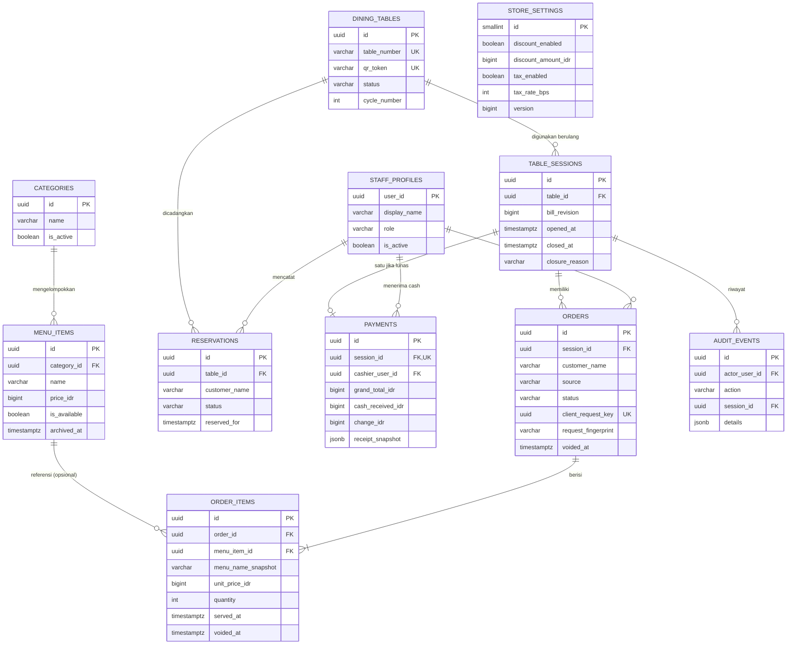
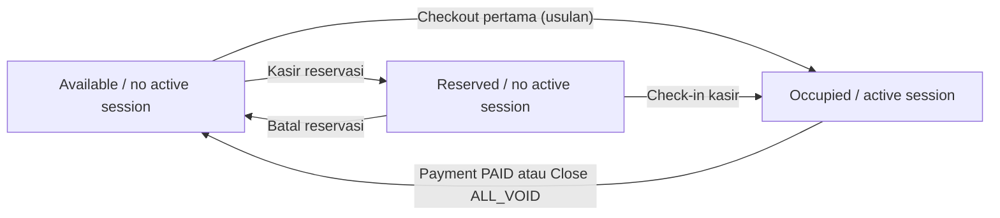
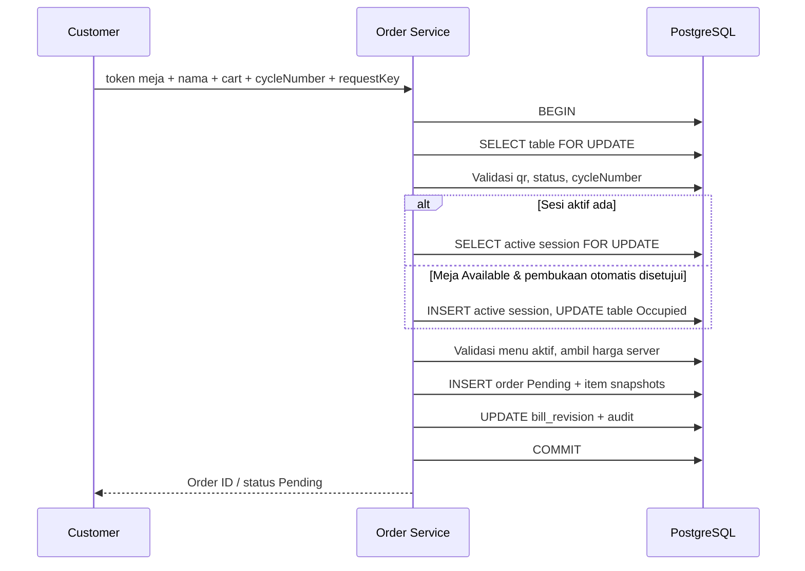

# 05 — Database Design & Entity Relationship Diagram (ERD)

## Restaurant POS & QR-Based Self-Ordering System

| Metadata | Nilai |
|---|---|
| Versi | **1.2 — BE-02 schema implementation** |
| Tanggal | **10 Oktober 2026** |
| Lokasi repository | `docs/05-database-design.md` |
| Berdasarkan | PRD v1.2, Business Rules v1.2, User Flows v1.2, System Architecture v1.0 |
| Database | **NeonDB (PostgreSQL)** |
| ORM / migrasi | **Drizzle ORM + Drizzle Kit** (`src/db/schema.ts`, `drizzle/`) |
| Arsitektur | **Next.js modular monolith**, satu outlet |
| Referensi SQL | [`05-schema-reference.sql`](05-schema-reference.sql) — DDL referensi; jalankan migrasi versi di `drizzle/` |
| Dokumen berikutnya | `06-api-specification.md` |

> **Label keputusan:** **Disepakati** = kebutuhan bisnis dari diskusi; **Rancangan** = pemodelan teknis yang disarankan dan dapat direvisi; **Terbuka** = keputusan yang belum dipastikan. Skema ini bukan bukti bahwa aturan bisnis lintas tabel telah otomatis ditegakkan database; sebagian membutuhkan service + transaksi di backend.

---

## 1. Tujuan dan batasan desain

Tujuan: memastikan pemesanan via QR, additional order, checklist Served, pembayaran tunai penuh, reservasi manual, dan perubahan pajak/diskon live dapat berjalan **tanpa kehilangan histori dan tanpa tagihan ganda**.

**Keputusan bisnis yang wajib dipertahankan:**

1. Satu QR Code statis unik per meja; pelanggan memasukkan nama sebelum melihat menu, tanpa login dan tanpa PIN.
2. Meja memiliki **hanya** `AVAILABLE`, `OCCUPIED`, `RESERVED`; sesi meja internal memiliki fase aktif/ditutup yang terpisah.
3. Setiap meja maksimal satu sesi aktif. Banyak `orders` boleh masuk ke sesi itu; setiap order mempunyai nama pemesan, sehingga beberapa orang satu meja dapat memesan sendiri.
4. Status pelayanan order **hanya** `PENDING`, `PREPARING`, `SERVED`. Kasir menerima order, lalu mencentang Served **per baris item**; seluruh kuantitas dalam baris dianggap disajikan bersamaan (MVP).
5. Void hanya oleh kasir **sebelum pembayaran**. Item Served boleh di-void **hanya** untuk kesalahan pegawai dengan alasan dan audit. Void **bukan** status pelayanan keempat.
6. Satu pembayaran **cash penuh** per sesi di akhir, tidak ada split bill. Pembayaran hanya boleh ketika semua order aktif non-void telah Served.
7. Tagihan unpaid menggunakan **konfigurasi diskon nominal/pajak persentase terbaru**. Pajak dihitung dari subtotal **sebelum diskon**. Pembayaran yang sudah selesai menyimpan snapshot yang tidak berubah.
8. Semua item void → sesi ditutup tanpa payment/revenue; meja Available; histori tetap tersimpan meskipun hilang dari tampilan aktif.
9. Admin dapat membuat menu **Inactive** (tidak tampil ke pelanggan). **Tidak ada** kolom stok, resep, ingredients, printer struk, atau gateway pembayaran.
10. Reservasi dicatat kasir, ditandai fisik di restoran, dan check-in manual; tidak ada booking online / auto-expiry.

**Batasan DB MVP:** satu outlet, satu mata uang (`IDR`), nilai uang integer rupiah, ID UUID untuk record bisnis, waktu `timestamptz` UTC di DB (UI menampilkan Asia/Jakarta), relasi dengan foreign key, soft archive untuk master menu.

---

## 2. Model relasi keseluruhan (ERD)



**Interpretasi:** `DINING_TABLES` → `TABLE_SESSIONS` adalah **1:N sepanjang waktu**, tetapi **maksimal satu sesi aktif**. `TABLE_SESSIONS` → `ORDERS` adalah **1:N**. `TABLE_SESSIONS` → `PAYMENTS` adalah **1:0..1**; sesi all-void **tidak punya payment**. `MENU_ITEMS` pada order item hanya FK referensi, sedangkan harga/nama yang dibeli adalah **snapshot**. `STORE_SETTINGS` adalah **singleton** (satu record untuk satu outlet), tidak dihubungkan dengan FK ke semua sesi karena unpaid selalu memakai setting terkini.

Catatan: relasi staf dalam diagram disederhanakan; seluruh `accepted_by`, `served_by`, `voided_by`, `updated_by`, dan `closed_by` juga merujuk staf sesuai tabel detail.

---

## 3. Kamus data utama

### 3.1 `staff_profiles` — role Admin/Kasir

**Kolom:** `user_id UUID PK`, `display_name VARCHAR(120)`, `role VARCHAR(12)` (`ADMIN`/`CASHIER`), `is_active BOOLEAN`, `created_at`, `updated_at`.

- Kredensial **tidak** disimpan di tabel ini. Neon Managed Better Auth menangani tabel autentikasi di schema `neon_auth`.
- `user_id` mengacu ke `neon_auth.user.id` (`UUID`), diverifikasi pada Neon `production` yang ter-link. Migrasi auth tetap dikelola Neon.
- Nonaktifkan staf melalui `is_active=false`, jangan hapus akun yang menjadi pemilik transaksi historis.

### 3.2 `dining_tables` — daftar meja

| Kolom | Tipe | Aturan |
|---|---|---|
| `id` | `UUID PK` | Identitas internal |
| `table_number` | `VARCHAR(30) UNIQUE NOT NULL` | Misalnya `05`, `A-02` |
| `qr_token` | `VARCHAR(128) UNIQUE NOT NULL` | Token acak tidak mudah ditebak, **bukan nomor meja** |
| `status` | `VARCHAR(12) NOT NULL` | `AVAILABLE`, `OCCUPIED`, `RESERVED` |
| `cycle_number` | `INT NOT NULL DEFAULT 0` | Bertambah saat sesi ditutup; mencegah checkout tab lama ke pelanggan baru (**Rancangan**) |
| `is_active` | `BOOLEAN` | Meja bisa disembunyikan/ditarik dari layanan |
| `created_at`, `updated_at` | `TIMESTAMPTZ` | Metadata |

Tidak ada `CLEANING`. `qr_token` tidak dipakai sebagai credential staff maupun bukti keberadaan fisik.

### 3.3 `table_sessions` — kunjungan / tagihan gabungan

| Kolom | Tipe | Aturan |
|---|---|---|
| `id` | `UUID PK` | Satu sesi kunjungan |
| `table_id` | `UUID FK` | Meja terkait |
| `opened_at` | `TIMESTAMPTZ` | Awal sesi |
| `opened_by_user_id` | `UUID FK NULL` | NULL untuk pembukaan oleh checkout QR |
| `bill_revision` | `BIGINT DEFAULT 1` | Naik saat isi/progres tagihan berubah |
| `closed_at` | `TIMESTAMPTZ NULL` | NULL = sesi masih aktif |
| `closure_reason` | `PAID` / `ALL_VOID` / NULL | **Status internal penutupan**, bukan status meja |
| `closed_by_user_id` | `UUID FK NULL` | Kasir yang menyelesaikan sesi |

**Constraint utama:**

```sql
CREATE UNIQUE INDEX table_sessions_one_active_per_table
ON table_sessions(table_id)
WHERE closed_at IS NULL;
```

Indeks parsial ini menjamin **maksimal satu sesi aktif per meja**, bahkan saat dua checkout pertama bersamaan. Index ini **tidak** melarang meja dipakai lagi sesudah sesi lama ditutup.

### 3.4 `categories` dan `menu_items` — katalog tanpa stok

`categories`: `id`, `name`, `sort_order`, `is_active`, `created_at`.

`menu_items`: `id`, `category_id FK`, `name`, `description`, `image_url`, `price_idr BIGINT`, `is_available BOOLEAN`, `archived_at NULL`, `created_at`, `updated_at`.

**Query katalog publik:** hanya kategori aktif + menu `is_available=true` + `archived_at IS NULL`. Backend memeriksa kembali saat checkout; menu yang berubah Inactive sejak cart dibuat **ditolak**. “Hapus menu” di admin = archive (`archived_at`), bukan menghapus histori. **Tidak ada stok/resep.**

### 3.5 `orders` — header pesanan

| Kolom | Tipe | Aturan |
|---|---|---|
| `id` | `UUID PK` | Identitas order |
| `session_id` | `UUID FK` | Semua order awal/tambahan dalam satu sesi |
| `customer_name` | `VARCHAR(120) NOT NULL` | Wajib pada QR, juga diisi untuk manual |
| `source` | `QR` / `MANUAL` | Dari pelanggan / kasir |
| `status` | `PENDING` / `PREPARING` / `SERVED` | **Tepat tiga status** |
| `client_request_key` | `UUID UNIQUE NOT NULL` | Idempotensi checkout, juga untuk manual |
| `request_fingerprint` | `TEXT NOT NULL` (SHA-256 hex, 64 karakter) | Membandingkan payload semantik saat key diulang; tidak menyimpan guest token |
| `created_by_user_id` | `UUID FK NULL` | Kasir bila input manual |
| `accepted_at`, `accepted_by_user_id` | timestamp / FK nullable | Konfirmasi kasir |
| `voided_at` | timestamp nullable | Ditandai bila seluruh item order telah di-void; metadata, bukan status keempat |
| `note`, `created_at`, `updated_at` | metadata | Catatan & waktu |

**Order dari QR** dimulai `PENDING`. Order manual oleh kasir dapat langsung `PREPARING` (**rancangan mengikuti dokumen 04**). Kasir mengonfirmasi `PENDING → PREPARING`; item checklist Served kemudian memicu `PREPARING → SERVED` saat semua baris item valid telah dicentang.

### 3.6 `order_items` — snapshot dan checklist per baris

| Kolom | Tipe | Aturan |
|---|---|---|
| `id`, `order_id`, `menu_item_id` | UUID / FK | Referensi baris dan produk |
| `menu_name_snapshot` | VARCHAR(160) | Nama saat order dibuat |
| `unit_price_idr` | BIGINT ≥ 0 | Harga saat order dibuat |
| `quantity` | INT > 0 | Kuantitas, tanpa split served per porsi |
| `line_total_idr` | BIGINT generated | `quantity × unit_price_idr` |
| `customer_note` | TEXT NULL | Misalnya tanpa es |
| `served_at`, `served_by_user_id` | timestamp / FK nullable | Checklist Served oleh staf |
| `voided_at`, `voided_by_user_id` | timestamp / FK nullable | Penandaan void oleh kasir |
| `void_reason_type` | `CUSTOMER_REQUEST` / `EMPLOYEE_ERROR` | Kategori pembatalan |
| `void_reason_detail` | TEXT NULL | Alasan spesifik yang dapat diaudit |

**Aturan:** item dengan `voided_at IS NOT NULL` tidak ikut perhitungan tagihan. Item yang sudah `served_at IS NOT NULL` **hanya dapat void dengan `EMPLOYEE_ERROR`** (sebelum payment). Jangan hapus fisik order item hanya karena dibatalkan; setelah Paid, update item harus ditolak.

### 3.7 `store_settings` — pengaturan billing global

| Kolom | Tipe | Aturan |
|---|---|---|
| `id` | `SMALLINT PK`, selalu `1` | Singleton satu outlet |
| `store_name` | VARCHAR(200) | Ditampilkan pada preview struk |
| `discount_enabled` | BOOLEAN | Toggle Admin |
| `discount_amount_idr` | BIGINT ≥ 0 | Diskon **nominal tetap** |
| `tax_enabled` | BOOLEAN | Toggle Admin |
| `tax_rate_bps` | INT 0..10000 | Tax dalam **basis points**; `1000 = 10%` |
| `version` | BIGINT ≥ 1 | Naik **setiap** update aturan billing |
| `updated_by_user_id`, `updated_at` | FK / timestamp | Audit |

**Penting:** `table_sessions` **tidak** mempunyai snapshot setting saat dibuka. Unpaid selalu membaca `store_settings` terkini. Payment menyimpan setting yang digunakan pada waktu pelunasan.

### 3.8 `payments` — satu transaksi sukses per sesi

| Kolom | Tipe | Aturan |
|---|---|---|
| `id` | UUID PK | Identitas payment |
| `session_id` | UUID **UNIQUE** FK | Maksimal **satu payment** per sesi |
| `cashier_user_id` | UUID FK | Penerima tunai |
| `idempotency_key` | UUID **UNIQUE** | Mencegah pembayaran ganda dari retry |
| `method` | `CASH` | Cash only |
| `subtotal_idr` | BIGINT | Snapshot subtotal non-void |
| `discount_enabled`, `configured_discount_idr`, `discount_applied_idr` | bool, BIGINT | Snapshot konfigurasi dan diskon yang terpakai |
| `tax_enabled`, `tax_rate_bps`, `tax_amount_idr` | bool, INT, BIGINT | Snapshot pajak |
| `grand_total_idr` | BIGINT | Total final ≥ 0 (diskon penuh mungkin menghasilkan nol) |
| `cash_received_idr`, `change_idr` | BIGINT | Uang diterima, kembalian |
| `session_revision`, `settings_version` | BIGINT | Versi quote pada saat pembayaran |
| `receipt_snapshot` | JSONB | Detail struk digital final termasuk nama item, qty, harga, total, nomor meja, nama toko |
| `paid_at` | TIMESTAMPTZ | Waktu pembayaran |

**Catatan total nol:** bila seluruh harga tertutup diskon dan pajak tidak aktif, total dapat Rp0 meskipun masih ada item valid. Tetap catat satu `payment` sukses bernilai nol untuk menutup sesi; ini **bukan** sesi ALL_VOID karena baris item tidak di-void.

**Unpaid bukan record payment berstatus `UNPAID`**: pembayaran hanya dibuat ketika kasir berhasil melunasi sesi. Untuk menentukan lunas/tidak, backend memeriksa apakah ada payment pada sesi. Sesi `ALL_VOID` memang tidak memiliki payment.

### 3.9 `reservations` — reservasi manual

`id`, `table_id`, `customer_name`, `customer_contact`, `guest_count`, `reserved_for`, `notes`, `status` (`RESERVED` / `CHECKED_IN` / `CANCELLED`), `created_by_user_id`, `created_at`, `updated_at`.

Status reservasi **internal** dan tidak menambahkan status meja baru. Satu meja maksimal punya satu reservasi `RESERVED` yang sedang memblokir meja pada MVP; pembatasan ini lebih sederhana daripada sistem kalender. Reservasi yang batal tetap menjadi histori. Nomor kontak hanya terlihat oleh staff.

### 3.10 `audit_events` — jejak tindakan penting

`id`, `actor_user_id` (nullable untuk customer/system), `actor_type`, `action`, `entity_type`, `entity_id`, `table_id`, `session_id`, `reason`, `details JSONB`, `created_at`.

Contoh event: `ORDER_ACCEPTED`, `ITEM_SERVED`, `ITEM_VOIDED`, `SESSION_CLOSED_ALL_VOID`, `CASH_PAYMENT_CONFIRMED`, `BILLING_SETTINGS_CHANGED`, `RESERVATION_CREATED`, `RESERVATION_CANCELLED`, `TABLE_CHECKED_IN`. Gunakan append-only dari business service; batasi akses publik dan hindari menyimpan data kontak sensitif berlebihan di `details`.

---

## 4. Aturan state lintas tabel

| Invariant | Penegakan |
|---|---|
| Satu sesi aktif per meja | **DB**: unique partial index `table_sessions(table_id) WHERE closed_at IS NULL` |
| Satu payment per sesi | **DB**: `UNIQUE(payments.session_id)` |
| Permintaan checkout tidak membuat order dobel | **DB**: `UNIQUE(orders.client_request_key)` + **service** membandingkan `request_fingerprint` sebelum mengembalikan hasil lama |
| `dining_tables.status = OCCUPIED` ↔ memiliki sesi aktif | **Service transaction** (check-in, checkout pertama, pembayaran, all-void) + integration test; sulit dinyatakan sebagai CHECK antar tabel |
| Meja `RESERVED` tidak dipakai checkout publik | **Service** dengan lock meja + cek status |
| `PENDING → PREPARING → SERVED` | **Service state machine**, penolakan transisi ilegal; CHECK DB membatasi nilai enum |
| Baris Served hanya void karena employee error | **DB CHECK** untuk metadata item + **service** memeriksa actor, alasan, unpaid |
| Semua active order Served sebelum payment | **Service** di transaksi, query semua order & item non-void |
| Tagihan berubah live sebelum pembayaran | **Service** membaca `store_settings` terkini pada quote baru |
| Quote stale tidak boleh dilunasi | **Service** membandingkan `(bill_revision, settings_version)` di bawah lock |
| Sesi PAID harus punya payment; ALL_VOID tidak punya payment | **Service** transaksi atomik; dapat diperkuat dengan trigger tertunda bila kelak diperlukan |
| Setelah Paid data item tidak boleh berubah | **Service authorization/validation** + test integrasi; bisa ditambah trigger/permission di tahap hardening |
| Meja Available lagi saat payment selesai | **Service** commit payment + close session + update table dalam satu transaksi |

> Menambah constraint lain lewat migration direkomendasikan bila sudah teruji. Jangan mengasumsikan foreign key sendiri dapat mengecek status antar tabel.

---

## 5. Perhitungan bill: satu sumber kebenaran

**Semua bilangan uang disimpan dalam rupiah bulat** (`BIGINT`), bukan floating point. Dalam kode TypeScript, gunakan `bigint` atau parsing/serialisasi yang eksplisit (misalnya angka rupiah sebagai string JSON) agar tidak kehilangan presisi.

```text
subtotal      = SUM(order_items.quantity * order_items.unit_price_idr)
                untuk semua baris item non-void dari sesi aktif

discount      = discount_enabled ? MIN(discount_amount_idr, subtotal) : 0

tax           = tax_enabled ? ROUND(subtotal * tax_rate_bps / 10000) : 0
                // pajak dihitung dari subtotal SEBELUM diskon

grand_total   = subtotal - discount + tax

change        = cash_received - grand_total
```

**Contoh:** subtotal Rp150.000, diskon aktif Rp10.000, pajak aktif 10% → pajak Rp15.000 dan total **Rp155.000**. Diskon dan pajak dikenakan **sekali per sesi**, bukan per order tambahan.

Implementasi pembulatan tanpa floating point (jumlah positif, half-up per rupiah):

```ts
function calculateTax(subtotalIdr: bigint, taxRateBps: bigint): bigint {
  return (subtotalIdr * taxRateBps + 5000n) / 10000n;
}
```

**Rancangan:** `tax_rate_bps=1000` berarti 10%; 10000 bps = 100%. Tetap validasi tarif sesuai ketentuan pajak yang benar pada bisnis riil. Aplikasi ini memakai simulasi pengaturan admin untuk keperluan demo.

### 5.1 Quote untuk pembayaran

Contoh respons service billing (JSON hanya contoh kontrak, bukan API final):

```json
{
  "tableId": "...",
  "sessionId": "...",
  "sessionRevision": "8",
  "settingsVersion": "4",
  "subtotalIdr": "150000",
  "discountIdr": "10000",
  "taxIdr": "15000",
  "grandTotalIdr": "155000",
  "paymentEligible": true
}
```

Kasir mengirim versi yang dilihatnya, nominal uang diterima, dan idempotency key. Backend mengunci ulang, menghitung ulang, lalu mengembalikan **409 BILL_CHANGED** jika `sessionRevision` atau `settingsVersion` tidak cocok. UI harus menampilkan nominal baru dan meminta konfirmasi ulang. Ini berlaku bahkan jika perubahan konfigurasi kebetulan menghasilkan angka total sama; perubahan setting tetap perlu ditinjau.

**Snapshot Paid** dapat menjadi sumber preview struk permanen. Berbeda dari quote unpaid, struk historis **tidak** membaca `store_settings` versi terbaru.

---

## 6. State machine dan aturan lifecycle

### 6.1 Tabel / sesi



- Saat penutupan sesi, `table_sessions.closed_at` dan `closure_reason` diisi, payment (jika PAID) disimpan, `dining_tables.status = AVAILABLE`, serta `cycle_number = cycle_number + 1`.
- **Terbuka / OD-01:** Pembukaan sesi otomatis saat checkout pertama pada meja Available **masih usulan**, karena user belum mengonfirmasi keputusan tersebut. Alternatif: kasir membuka sesi dulu tanpa mengubah model data utama.
- **Rancangan check-in:** reservasi `RESERVED` → `CHECKED_IN`, buat sesi aktif dan status meja Occupied di transaksi yang sama.

### 6.2 Order / served checkbox


Status **void tidak ditambahkan**. `order_items.voided_at` menunjukkan baris yang dibatalkan. `orders.voided_at` mengidentifikasi order yang seluruh itemnya sudah di-void; order tersebut tidak disertakan pada antrean aktif dan tidak menahan pembayaran.

- Checkbox per baris: `served_at IS NULL` = belum disajikan; `served_at IS NOT NULL` = seluruh qty baris disajikan.
- Order menjadi Served jika masih memiliki setidaknya satu baris non-void dan seluruh baris tersebut Served.
- Jangan mengizinkan checkout terhadap sesi yang sudah Closed.
- Bila seluruh order di sesi hanya menyisakan void → kasir memakai operasi `close-all-void`, **tanpa** membuat payment.

---

## 7. Alur transaksi kritis (PostgreSQL)

### 7.1 Checkout QR / additional order



- `client_request_key` unik: jika request yang **sama** diulang, service mengembalikan **order lama**; cek bahwa payload relevan tidak berubah untuk key yang sama.
- `cycle_number` dibaca dari halaman saat scan. Saat sesi sudah ditutup, nomor siklus meja bertambah; tab lama tidak boleh membuka sesi tamu berikutnya secara diam-diam (**Rancangan**).
- Dua pelanggan scan pada siklus yang sama dapat menggunakan sesi aktif yang sama meskipun checkout mereka hampir bersamaan.
- QR statis tanpa PIN **tidak bisa membuktikan lokasi**; token + nama + cycle guard adalah mitigasi UX/konsistensi, bukan autentikasi lokasi. Tetap gunakan rate limit dan review Pending oleh kasir.

### 7.2 Checklist Served dan void

1. Kasir autentikasi/RBAC; server kunci baris meja → sesi → order/item sesuai urutan konsisten.
2. Checkbox Served menyimpan `served_at`, `served_by_user_id`, audit, lalu mengevaluasi apakah seluruh baris non-void pada order Served.
3. Void sebelum Paid: wajib `void_reason_type` dan `void_reason_detail`; jika item `served_at` sudah ada, hanya `EMPLOYEE_ERROR` dengan rincian masuk akal. Seluruh void dilakukan oleh kasir/admin terotorisasi.
4. Setelah Served/void, tingkatkan `bill_revision` sesi (bahkan bila nominal sama, supaya quote payment yang terbuka dievaluasi ulang).
5. Setelah seluruh item order di-void, isi `orders.voided_at`; **jangan** hard-delete item/order.

### 7.3 Pelunasan full cash (paling kritis)

```mermaid
sequenceDiagram
    participant K as Cashier
    participant S as Payment Service
    participant DB as PostgreSQL
    K->>S: Konfirmasi Cash + expected revisions + idempotencyKey
    S->>DB: BEGIN
    S->>DB: Lock store_settings (FOR SHARE)
    S->>DB: Lock dining_table lalu active session (FOR UPDATE)
    S->>DB: Recheck revisions + status Active
    S->>DB: Recheck seluruh non-void order Served
    S->>DB: Hitung total dari item snapshots + latest settings
    alt Quote stale / order baru / belum Served / cash kurang
      S->>DB: ROLLBACK
      S-->>K: 409 conflict atau validation error; quote baru
    else Valid & jumlah active item > 0
      S->>DB: INSERT payment + receipt_snapshot
      S->>DB: UPDATE session: closed_at, reason PAID
      S->>DB: UPDATE table: Available, cycle + 1
      S->>DB: INSERT audit event
      S->>DB: COMMIT
      S-->>K: Payment success + preview struk digital
    end
```

**Kenapa mengunci settings?** Jika Admin mengubah pajak tepat saat kasir membayar, lock membuat salah satu operasi terjadi lebih dulu; bila setting lebih dulu berubah, expected version menjadi stale. Jika pembayaran lebih dulu commit, snapshot disimpan dan setting baru tidak mengubahnya.

**Lock order disarankan:** payment `store_settings` (shared lock) → `dining_tables` → `table_sessions`; operasi order/void/served mengunci `dining_tables` → `table_sessions`. Admin billing update mengunci hanya baris `store_settings`. Setiap service konsisten dengan pola ini untuk menekan deadlock. Gunakan satu connection/transaction `pg` interaktif melalui Drizzle (bukan beberapa query independen).

**Kegagalan setelah commit:** jika network timeout terjadi sesudah payment berhasil, klien perlu memeriksa payment/session memakai idempotency key sebelum mengulang; jangan menganggap timeout berarti belum dibayar. `UNIQUE(payments.session_id)` adalah perlindungan terakhir dari double payment.

### 7.4 Penutupan sesi ALL_VOID

Di bawah lock meja/sesi, server memeriksa **tidak ada baris order item non-void** dan **tidak ada payment**. Lalu isi `closed_at`, `closure_reason = ALL_VOID`, ubah meja Available, naikkan `cycle_number`, tulis audit; **tidak ada** insert payment dan tidak ada revenue. Order/void tetap dalam database untuk histori internal.

### 7.5 Reservasi

Kasir dapat membuat reservasi **hanya pada meja Available** (dengan lock meja). Insert `reservations(status=RESERVED)` + ubah meja `RESERVED` dalam transaksi yang sama. Saat check-in, ubah reservation `CHECKED_IN`, buat active session, ubah meja `OCCUPIED`; bila batal, ubah reservation `CANCELLED` dan meja `AVAILABLE`. Tidak melakukan auto-expiry atau alokasi jadwal berulang.

---

## 8. Query operasional penting (contoh)

### 8.1 Cari sesi aktif suatu meja

```sql
SELECT s.id, s.bill_revision, s.opened_at
FROM table_sessions s
WHERE s.table_id = $1 AND s.closed_at IS NULL;
```

### 8.2 Total subtotal sebelum diskon/pajak

```sql
SELECT COALESCE(SUM(i.line_total_idr), 0)::bigint AS subtotal_idr
FROM table_sessions s
JOIN orders o ON o.session_id = s.id
JOIN order_items i ON i.order_id = o.id
WHERE s.id = $1
  AND s.closed_at IS NULL
  AND i.voided_at IS NULL;
```

### 8.3 Guard semua pesanan Served saat pembayaran

```sql
-- Harus ada item non-void, dan tidak boleh ada order non-void
-- yang masih Pending / Preparing.
SELECT
  COUNT(*) AS active_item_lines,
  COUNT(*) FILTER (WHERE o.status <> 'SERVED') AS unserved_item_lines
FROM orders o
JOIN order_items i ON i.order_id = o.id
WHERE o.session_id = $1
  AND i.voided_at IS NULL;
```

Service memerlukan `active_item_lines > 0 AND unserved_item_lines = 0`; pemeriksaan ini dilakukan **di dalam transaksi** setelah lock dan sebelum payment dibuat. Jangan mengambil keputusan dari status UI tanpa query ulang.

### 8.4 Revenue historis per hari (berdasarkan Paid)

```sql
SELECT
  (paid_at AT TIME ZONE 'Asia/Jakarta')::date AS business_date,
  COUNT(*) AS paid_sessions,
  SUM(grand_total_idr) AS revenue_idr
FROM payments
GROUP BY (paid_at AT TIME ZONE 'Asia/Jakarta')::date
ORDER BY business_date DESC;
```

Dashboard grafik custom membaca hasil query API ini. **Jumlah order tidak sama dengan jumlah pembayaran** karena satu meja dapat memiliki additional order.

### 8.5 Preview struk digital

```sql
SELECT p.receipt_snapshot, p.paid_at, p.cash_received_idr, p.change_idr
FROM payments p
WHERE p.id = $1;
```

Preview setelah Paid **tidak menghitung ulang** dari menu/setting terbaru. Sebelum Paid, UI menampilkan **estimasi bill**, bukan struk final.

---

## 9. Index, keys, dan referential integrity

| Constraint/index | Tujuan |
|---|---|
| `UNIQUE(dining_tables.table_number)` | Tidak ada dua nomor meja sama |
| `UNIQUE(dining_tables.qr_token)` | QR per meja unik |
| `UNIQUE INDEX table_sessions(table_id) WHERE closed_at IS NULL` | Maksimal satu sesi aktif |
| `UNIQUE(orders.client_request_key)` | Idempotensi checkout |
| `UNIQUE(payments.session_id)` | Maksimal satu pembayaran per sesi |
| `UNIQUE(payments.idempotency_key)` | Retry payment aman |
| `INDEX orders(session_id, created_at)` | Riwayat order sesi |
| `INDEX order_items(order_id)` | Bill dan checklist cepat |
| `INDEX payments(paid_at DESC)` | Revenue / laporan |
| `UNIQUE INDEX reservations(table_id) WHERE status = 'RESERVED'` | Hanya satu reservasi yang mengunci satu meja |
| `INDEX audit_events(session_id, created_at DESC)` | Investigasi void dan pembayaran |

**Referential integrity:** `ON DELETE RESTRICT` untuk sesi/order/payment yang berhubungan dengan histori. `ON DELETE SET NULL` pada `order_items.menu_item_id` hanya fallback teknis jika produk terhapus fisik, tetapi tindakan admin tetap **archive**. Gunakan `UNIQUE` + transaksional service untuk konsistensi, bukan mengandalkan validasi form.

**Single-row settings:** `store_settings.id = 1`, hanya admin boleh update, dan update harus `version = version + 1` di dalam transaksi. Jangan membuat beberapa konfigurasi toko pada MVP.

---

## 10. Mapping ke Drizzle ORM (rancangan)

Konsep indeks parsial di Drizzle didukung melalui `.where(sql\`...\`)` pada `uniqueIndex`. Contoh *potongan* schema yang perlu disesuaikan dengan keseluruhan definisi modul:

```ts
import { pgTable, uuid, timestamp, bigint, uniqueIndex } from 'drizzle-orm/pg-core';
import { sql } from 'drizzle-orm';

export const tableSessions = pgTable('table_sessions', {
  id: uuid('id').primaryKey().defaultRandom(),
  tableId: uuid('table_id').notNull(), // FK ditambahkan ke diningTables
  billRevision: bigint('bill_revision', { mode: 'bigint' })
    .notNull().default(1n),
  openedAt: timestamp('opened_at', { withTimezone: true })
    .notNull().defaultNow(),
  closedAt: timestamp('closed_at', { withTimezone: true }),
}, (t) => [
  uniqueIndex('table_sessions_one_active_per_table')
    .on(t.tableId)
    .where(sql`${t.closedAt} IS NULL`),
]);
```

Pilih `bigint` mode secara konsisten agar API tidak mengirim JavaScript `BigInt` mentah ke `JSON.stringify`. Seluruh angka uang dan version pada API disarankan sebagai string desimal, kemudian validasi/parsing eksplisit di server/client.

**Struktur file Drizzle (rancangan):**

```text
src/db/
  index.ts
  schema/
    auth.ts                 # mapping read-only Neon Managed Auth, jika dibutuhkan
    staff.ts
    tables.ts
    reservations.ts
    menu.ts
    sessions.ts
    orders.ts
    payments.ts
    settings.ts
    audit.ts
    relations.ts
  migrations/
```

Kode produksi harus menggunakan migrasi yang direview, bukan menjalankan DDL referensi langsung tanpa menyesuaikan skema autentikasi dan finalisasi OD-01.

---

## 11. Data contoh dan walkthrough

**Skenario Meja 05:**

1. Meja `05` status Available, `cycle_number=6`.
2. Pelanggan **Alya** scan QR, isi nama, checkout: sesi `SES-101`, order `ORD-1` Pending (`Nasi Goreng ×2 = Rp60.000`). Meja Occupied (**baseline jika auto-open disetujui**).
3. Kasir terima order → Preparing; mencentang Nasi Goreng Served → order Served.
4. Pelanggan **Bima** scan QR yang sama, isi nama, membuat additional order `ORD-2` Pending (`Es Teh ×2 = Rp20.000`) ke sesi **SES-101**, bukan membuat tagihan baru.
5. Kasir menerima dan mengantar order Bima; ketika Served semuanya, pembayaran diizinkan.
6. Subtotal sesi **Rp80.000**. Admin menghidupkan pajak 10% dan diskon Rp5.000; unpaid bill live menjadi `80.000 - 5.000 + 8.000 = Rp83.000`.
7. Kasir menerima tunai Rp100.000; kembalian Rp17.000, menyimpan **satu payment** dengan receipt snapshot dua order tadi.
8. Sesi SES-101 ditutup `PAID`, meja Available, `cycle_number=7`. Harga/menu/pajak yang diubah besok tidak mengubah struk transaksi tadi.

---

## 12. Acceptance test database yang wajib lulus

| ID | Test | Hasil yang diwajibkan |
|---|---|---|
| DB-01 | Dua checkout pertama bersamaan pada meja sama | Maksimal satu sesi Active; tidak membuat tagihan terpisah |
| DB-02 | Checkout ulang dengan request key sama | Mengembalikan order lama, bukan menggandakan item |
| DB-03 | Additional order dari nama berbeda | Tetap sesi sama; nama masing-masing order tersimpan |
| DB-04 | Menu dinonaktifkan setelah masuk cart | Checkout gagal untuk menu itu |
| DB-05 | Admin mengubah harga menu setelah order dibuat | `unit_price_idr` pesanan lama tetap |
| DB-06 | Item belum Served tetapi kasir mencoba bayar | Payment ditolak di backend |
| DB-07 | Dua kasir mencoba membayar sesi sama | Hanya satu payment row |
| DB-08 | Admin update pajak saat payment berlangsung | Snapshot hanya memakai satu versi konsisten; quote stale ditolak |
| DB-09 | Additional order masuk saat payment berlangsung | Tidak ada order di sesi Closed; quote lama ditolak jika order masuk lebih dulu |
| DB-10 | Item Served di-void karena permintaan biasa | Ditolak; alasan employee error dengan audit diperlukan |
| DB-11 | Semua item di-void | Close ALL_VOID, meja Available, tidak ada payment/revenue |
| DB-12 | Refresh setelah pembayaran | Meja Available; struk historis identik |
| DB-13 | Tab pelanggan lama checkout setelah meja direset | Mismatch `cycle_number` → 409; bukan otomatis masuk sesi tamu baru |
| DB-14 | Reservasi dibuat dari meja Occupied | Ditolak; tidak merusak sesi |
| DB-15 | Kasir tidak berwenang memodifikasi setting | Ditolak di server |
| DB-16 | SQL CHECK/FK/unique index | Menolak nilai negatif, role/status ilegal, session/payment duplikat |

Untuk uji transaksi paralel, gunakan PostgreSQL lokal dengan data fiktif, koneksi ganda, dan hitung jumlah row final. Jangan jalankan tes destruktif pada Neon yang ter-link. Unit test fungsi billing saja **tidak** cukup membuktikan keamanan pembayaran.

---

## 13. Migrasi, seed data, dan deployment

1. Gunakan project Neon yang sudah ter-link untuk data fiktif pengembangan/demo; simpan `DATABASE_URL` **hanya** pada environment variable server. Siapkan PostgreSQL lokal untuk tes mutasi.
2. Gunakan Neon Managed Auth yang sudah aktif; `neon_auth.user.id` telah diverifikasi UUID pada Neon yang ter-link. FK `staff_profiles.user_id` ada pada migrasi BE-02; migrasi auth dikelola Neon, bukan Drizzle aplikasi.
3. Buat Drizzle schema dan migration untuk tabel domain sesuai ERD; tambahkan index parsial, CHECK, FK, dan metadata.
4. Seed satu admin demo, satu kasir demo, 8–12 meja, kategori/menu foto dummy, dan singleton settings; jangan masukkan kredensial nyata ke repository.
5. Jalankan integration test race-condition, lalu E2E dari QR → Paid dan dari QR → ALL_VOID.
6. Semua perubahan skema setelah deploy harus memakai versioned migrations. Backup data Neon sebelum perubahan schema; jangan gunakan `push` langsung ke production tanpa review.

**Referensi:** [Drizzle + Neon](https://orm.drizzle.team/docs/connect-neon), [Drizzle Indexes & Constraints](https://orm.drizzle.team/docs/indexes-constraints), [PostgreSQL Partial Indexes](https://www.postgresql.org/docs/current/indexes-partial.html), [Neon Connection Pooling](https://neon.com/docs/connect/connection-pooling).

---

## 14. Keputusan terbuka dan review checklist

| ID | Keputusan | Status saat dokumen dibuat | Dampak |
|---|---|---|---|
| OD-01 | Sesi dibuat otomatis saat checkout pertama meja Available atau diaktifkan kasir? | **Terbuka**. Baseline di diagram: otomatis | Menentukan guard endpoint checkout dan tabel Available → Occupied |
| TD-01 | Tipe dan tabel user Neon Managed Auth yang ter-link | **Terverifikasi BE-02:** `neon_auth.user.id` UUID pada Neon `production` | FK `staff_profiles` + migrations |
| TD-02 | Simpan `cycle_number` table untuk menghambat checkout tab lama | **Rancangan disarankan** | Tambahan field request checkout; tidak mencegah QR dipotret |
| TD-03 | `receipt_snapshot` JSONB untuk struk digital | **Rancangan disarankan** | Bukti transaksi Paid tidak berubah dan UI struk sederhana |
| TD-04 | Void selalu seluruh baris item (bukan beberapa qty) | **Rancangan penyederhanaan MVP** | UX pembatalan dan implementasi `order_items` |
| TD-05 | Reservasi dibatasi satu status RESERVED aktif per meja | **Rancangan penyederhanaan MVP** | Belum mendukung kalender booking lanjutan |

**Checklist sebelum `06-api-specification.md`:** pastikan satu-satunya product decision yang masih kritis (OD-01) diputuskan; cek ERD/table list konsisten dengan PRD; pilih mapping auth schema; tentukan response API uang string; setujui strategi idempotency dan 409 stale quote; lalu kunci migrasi awal.

**Keluaran fase ini:** model ERD, kamus data lengkap, invariant, transaksi pembayaran, query penting, indeks, strategi migrasi, test plan, dan file SQL referensi untuk direview. Ini cukup sebagai landasan menyusun API Contract v1.0 tanpa mengubah keputusan bisnis yang telah disepakati.
