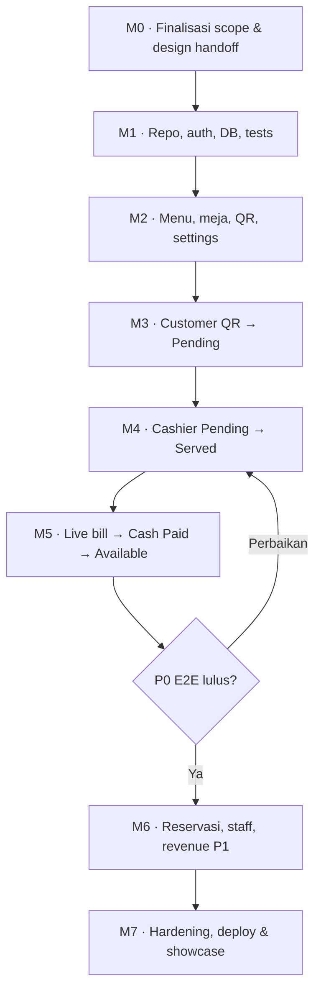

# 08 — Development Roadmap

## Restaurant POS & QR-Based Self-Ordering System

| Metadata | Detail |
|---|---|
| Versi | **1.0 — Implementation planning draft** |
| Tanggal | **10 Oktober 2026** |
| Repository target | `docs/08-development-roadmap.md` |
| Pemilik rencana | Solo developer — proyek portofolio |
| Produk | Restaurant POS untuk **satu outlet**, dine-in, QR table ordering |
| Stack acuan | Next.js App Router, TypeScript, Neon PostgreSQL, Drizzle ORM, Better Auth (rancangan), Zod, Tailwind CSS, shadcn/ui, TanStack Query; custom React/SVG charts |
| Package manager | npm (`package-lock.json`) |
| Arsitektur | Modular monolith, satu codebase / satu deployment |
| Referensi wajib | `01-prd-restaurant-pos.md` v1.2; `02-business-rules.md` v1.2; `03-user-flows.md` v1.2; `04-system-architecture.md` v1.0; `05-database-design.md` v1.0; `05-schema-reference.sql`; `06-api-specification.md` v1.0; `07-ui-ux-guidelines.md` v1.0; `docs/DESIGN.md` |
| Status | **Rencana**; bukan bukti fitur telah diimplementasikan |

> **Prinsip utama:** prioritaskan _vertical slice_ dari QR → checkout → order Pending → konfirmasi → checklist Served → pembayaran cash penuh → meja Available. Bangun modul pendukung secukupnya; hentikan penambahan fitur di luar MVP. **Aturan bisnis yang sudah disepakati tidak boleh diganti oleh desain UI atau keputusan coding agent.**

---

## 1. Product constraints (tidak dapat dinegosiasikan dalam P0)

- Customer scan **QR Code**, mengisi **nama sebelum membuka menu**, **tanpa login/PIN**; QR bukan QRIS pembayaran. Nama bukan verifikasi lokasi/identitas.
- `dining_tables.status`: **`AVAILABLE`, `OCCUPIED`, `RESERVED`** saja; **maksimal satu `table_session` aktif per meja**.
- Setiap checkout menghasilkan `order` sendiri. Additional order di meja yang sama dalam sesi aktif masuk ke **satu tagihan meja**, walaupun pemesannya berbeda.
- Order status hanya **`PENDING → PREPARING → SERVED`**. Setelah konfirmasi kasir → `PREPARING`; kasir mencentang **setiap baris item** (seluruh quantity pada baris dianggap tersaji); setelah semua item non-void dicentang → `SERVED` otomatis.
- Customer **tidak** dapat membatalkan order; kasir melakukan void **sebelum Paid** dengan alasan dan audit. Void sesudah Served hanya untuk **kesalahan pegawai**; void bukan status order keempat.
- Pembayaran **cash only**, **sekali penuh per sesi**, **tanpa split bill**, dan hanya jika **seluruh order non-void Served**. Konfirmasi Paid menutup sesi dan mengubah meja menjadi Available **dalam satu transaksi database**.
- Seluruh item void → kasir menutup sesi `ALL_VOID` tanpa payment/revenue. Item hilang dari daftar aktif, tetapi **tidak dihapus permanen dari histori/audit**.
- Admin mengendalikan menu `isAvailable`; **tidak ada stok, ingredient, resep**.
- Admin mengatur **diskon nominal Rp** dan **pajak persentase** dengan toggle terpisah. Unpaid bill memakai konfigurasi **terbaru**; **pajak = tarif × subtotal sebelum diskon**, bukan setelah diskon. **Paid = snapshot immutable**; perubahan toggle tidak memodifikasi histori.
- Reservasi **manual oleh kasir**; hanya memblokir/melepaskan status meja melalui tindakan kasir, tanpa self-booking.
- Struk hanya **preview digital**, tidak mencetak, tidak membuat PDF wajib, dan tanpa integrasi printer.
- Satu outlet, satu mata uang IDR, backend sumber kebenaran harga dan total; tidak ada gateway pembayaran, split bill, multi-outlet, KDS, atau dashboard inventory.

### 1.1 Prioritas

| Level | Definisi | Contoh |
|---|---|---|
| **P0** | Wajib untuk demo transaksi **end-to-end** dan integritas bisnis | QR, input nama, menu tersedia, kasir konfirmasi, checklist Served, billing, cash Paid, reset meja, struk digital, validasi/locking |
| **P1** | Mendukung manajemen outlet dan kualitas portfolio versi 1.0 | Reservasi manual, akun staf oleh admin, reporting revenue, custom charts, audit lebih terperinci |
| **P2** | Eksperimen di luar MVP, masuk backlog ide **tanpa** menghalangi release | Ekspor laporan, upload media yang lebih canggih, analitik lanjutan, optimasi realtime push |

**P0 demo** belum berarti seluruh fitur P1 siap. P1 diselesaikan setelah alur P0 stabil. Pada P0 tetap perlu **admin minimal** untuk membuat/mengatur menu, meja/QR, dan setting tax/discount, serta sebuah cara aman bootstrap akun staf; UI manajemen staf lengkap dapat P1.

---

## 2. Keputusan terbuka dan _decision gates_

Jangan menjadikan asumsi teknis sebagai kesepakatan produk. Putuskan hanya saat modul yang memerlukannya akan dikerjakan.

| Gate | Keputusan | Baseline rancangan (BELUM final) | Harus selesai sebelum | Pengujian yang terdampak |
|---|---|---|---|---|
| **G-01** | Checkout pertama otomatis membuka sesi saat meja Available, atau harus dibuka kasir? | **Auto-open saat checkout pertama**; meja Reserved baru bisa order setelah check-in | M3 checkout publik | Dua request serentak tidak menciptakan dua sesi; tidak bisa checkout Reserved tanpa check-in |
| **G-02** | Kasir salah mencentang Served: apakah ada undo? | MVP satu arah; koreksi beralasan/audit dapat ditambahkan | M4 Served UI/API | Transisi status dan histori koreksi |
| **G-03** | Provisioning akun staf Better Auth | Admin membuat akun awal (tanpa public signup); mekanisme password awal/invite perlu dipilih | M1 auth & M6 staff | Akun staff tidak dapat self-register |
| **G-04** | Apakah customer boleh melihat agregat tagihan satu meja? | P1 agregat nominal saja; tanpa daftar order/nama orang lain | M3 layar status; P1 bill-summary | Tidak mengekspos detail pihak lain |
| **G-05** | Penutupan sesi reservasi setelah check-in tetapi **belum ada order** | Perlu aturan/endpoint `close-empty` tersendiri; **tidak** memakai `close-all-void` | M6 reservasi | Session kosong ditutup tanpa payment atau void palsu |
| **G-06** | Order manual kasir masuk Pending atau langsung Preparing? | Langsung Preparing merupakan usulan di PRD/API | M4 manual order | Status konsisten dengan aksi kasir |
| **G-07** | Pembatalan quantity sebagian dalam satu baris? | MVP void seluruh baris item | M4 void | Subtotal konsisten; alasan wajib |
| **G-08** | Sumber foto menu saat MVP (URL eksternal tervalidasi atau upload via storage) | Image URL + placeholder aman untuk demo; upload endpoint media P2 di API | M2 menu CRUD/UI | Gambar valid, fallback, ukuran/perizinan |
| **G-09** | Bila admin mengganti setting tepat ketika pembayaran dieksekusi, aturan konflik? | Version recheck + snapshot dalam transaction yang diserialisasi | M5 payment | Tidak ada tagihan ambigu atau revenue salah |

**Release gate minimum:** G-01, G-02, G-03, G-06, G-07, G-08, G-09 diputuskan/didokumentasikan sebelum freeze P0. G-04 dan G-05 dapat tetap ditunda sampai fitur P1 jika UI tidak bergantung padanya.

### 2.1 _Schema/API alignment gate_ sebelum migrasi pertama

Dokumen `05` dan `06` merupakan **rancangan**, bukan migrasi yang sudah dijalankan. Pada M1, lakukan review bersama:

- Sinkronkan tipe ID (UUID untuk entitas bisnis, TEXT untuk auth user), nama enum, FK dan indeks; cocokkan tabel Better Auth yang **benar-benar** dihasilkan versinya.
- Tambahkan `orders.request_fingerprint` bila idempotency API membutuhkannya; pastikan `client_request_key` dan respons replay dirancang konsisten.
- Tentukan penyimpanan quote/bill revision + settings version dan aturan cycle QR stale; jangan menambahkan tabel baru tanpa kebutuhan nyata.
- Pastikan `payments.session_id` unik, unique index satu sesi aktif per meja, snapshot Paid, timestamp audit, dan constraints status tervalidasi.
- Buat Drizzle migration **versioned**. Jangan menjalankan SQL referensi dan Drizzle migration terpisah ke satu database tanpa rekonsiliasi.
- Catat setiap perubahan di `docs/05-database-design.md` dan `docs/06-api-specification.md` sebagai revisi terkontrol, bukan mengedit implementasi diam-diam.

---

## 3. Strategi delivery dan dependensi

**Jalur kritis:** M0 → M1 → M2 → M3 → M4 → M5 → M7. M6 dapat menyusul setelah alur P0 stabil. Jalankan review desain OpenDesign **bertahap**, sejajar dengan pengerjaan frontend pada setiap milestone, bukan menunggu semua layar selesai.



| Milestone | Hasil yang harus bisa **didemokan** | Dependency utama | Exit criteria |
|---|---|---|---|
| **M0** — Planning & design handoff | Backlog prioritas, keputusan blocking diselesaikan, 2 layar awal disetujui | Dokumen 01–07 + DESIGN.md | Tidak ada perubahan diam-diam terhadap business rules |
| **M1** — Foundation | App boot, auth staff, Neon schema migrated, seed data, pipeline tests | M0 + G-03 + schema/API alignment | `npm run build`, unit test, migrasi dan login role berjalan |
| **M2** — Master data P0 | Admin kelola menu/availability, meja + QR, diskon & pajak | M1 + G-08 | QR mengarah ke meja benar; inactive menu tak dapat dibeli; version setting naik |
| **M3** — QR ordering P0 | Scan QR → isi nama → cart → checkout → order Pending terlihat di inbox kasir | M2 + G-01 | Checkout retry tidak menduplikasi order; 2 customer satu meja → 1 sesi |
| **M4** — Kasir operations P0 | Confirm, manual order, served checklist, void dan `ALL_VOID` | M3 + G-02/G-06/G-07 | Hanya transaksi sah dapat lanjut; Served only when all active items served |
| **M5** — Financial close P0 | Bill live + full cash pay + digital receipt + Available | M4 + G-09 | Seluruh jalur QR → Paid & ALL_VOID lulus, konflik/duplikasi ditangani |
| **M6** — Store management P1 | Reservasi manual, kelola staf, dashboard revenue & custom charts | M5 + G-05 | Reservasi tidak bentrok; revenue dari Paid, role staff aman |
| **M7** — Release & portfolio | Responsive, a11y, test report, demo deployment, README dan rekaman demo | M5 (P0 release) atau M6 (v1.0 lengkap) | Release checklist lulus, tidak ada blocker/security critical |

### 3.1 Dua target rilis

- **R0 — P0 Functional MVP (akhir M5):** buktikan satu transaksi lengkap dari QR sampai meja Available dengan pembayaran tunai penuh, termasuk additional order, void dan live setting.
- **R1 — Portfolio v1.0 (akhir M7 setelah M6):** tambah reservasi, akses staf admin, revenue/custom chart, UX polish, automated tests, dan dokumentasi/demo publik.

**Estimasi kapasitas, bukan tenggat:** untuk solo developer part-time, gunakan **1 sprint = 1 siklus kerja/review**, bukan tanggal wajib. Milestone M2–M5 berisiko tinggi dan dapat memerlukan lebih dari satu sprint. Gunakan backlog aktual dan *velocity* pribadi setelah M1 untuk menentukan jadwal realistis; jangan memaksa tanggal jika pengujian finansial belum lolos.

---

## 4. Backlog terurut per milestone

**Keterangan:** `S` kecil, `M` sedang, `L` kompleks (estimasi relatif, bukan jam). `P0/P1` mengikuti scope produk. ID task stabil untuk branch, PR, issue, dan prompt coding agent. **Task selesai hanya jika acceptance criteria terkait diuji.**

### M0 — Scope, OpenDesign handoff & contracts

| ID | Task | Pri | Size | Bukti selesai |
|---|---|---|---|---|
| `PLAN-01` | Buat `docs/08-development-roadmap.md`, backlog issue/kanban dan traceability fitur | P0 | S | Task IDs dan status terlihat |
| `PLAN-02` | Review G-01 (auto-open vs manual), G-03, G-08; tandai keputusan pada dokumen induk | P0 | M | Decision log tanpa kontradiksi |
| `UX-01` | Berikan `docs/DESIGN.md` + docs 01–07 ke OpenDesign; pilih visual direction | P0 | S | Preview C02 Customer Catalog dan K01 Cashier Overview |
| `UX-02` | Review responsive, states dan flow C01 → C06, K01 → K09 serta desain A02/A05/A07 | P0 | M | Figma/design outputs/screenshots diberi status Approved / Needs revision |
| `PLAN-03` | Susun mapping UI screen → endpoint API → tabel database | P0 | M | Tidak ada tombol UI yang memerlukan endpoint tak dirancang |

**Gate:** UI OpenDesign boleh mengubah estetika, bukan logika status/menu/pembayaran. Buat keputusan desain sekecil mungkin per batch; jangan menunggu semua layar P1 selesai untuk coding P0.

### M1 — Repository, Neon, auth & engineering guardrails

| ID | Task | Pri | Size | Bukti selesai |
|---|---|---|---|---|
| `INF-01` | Inisialisasi Next.js + TypeScript strict, Tailwind, shadcn/ui, lint/format, alias dan folder modular | P0 | M | Build lint/typecheck hijau; modul terpisah |
| `INF-02` | Konfigurasi Neon **dev** PostgreSQL, `.env.example` tanpa secret, `pg` + Drizzle ORM | P0 | M | Health/query sederhana dari server, bukan client |
| `DB-01` | Review `05-schema-reference.sql` vs Drizzle + Better Auth; finalisasi constraint, enum dan index | P0 | L | Review schema disetujui dan migration pertama dihasilkan |
| `DB-02` | Jalankan migrasi versioned; seed 1 admin, 1 cashier, kategori/menu/meja/settings fiktif | P0 | M | Database dev bisa di-reseed; tidak menggunakan kredensial nyata |
| `AUTH-01` | Better Auth staff login, logout, sesi dan disable public signup | P0 | L | Customer tanpa login, admin/kasir punya sesi aman |
| `AUTH-02` | `requireStaff`, `requireAdmin`, account active guard, origin/CSRF strategy | P0 | M | Kasir ditolak endpoint admin dengan 403 |
| `INF-03` | Shared Zod schemas, response/error envelope, money IDR string serialization, utility timezone | P0 | M | Invalid payload 422; tidak ada BigInt JSON error |
| `QA-01` | Setup Vitest + integration DB tests + Playwright E2E, CI workflow | P0 | M | Semua smoke tests dijalankan otomatis |

**Gate:** test transaksi menggunakan **PostgreSQL sungguhan** (Neon dev branch atau Postgres lokal) agar constraint/locking yang diuji nyata; mocks untuk unit business logic saja.

### M2 — Menu, table QR, store settings (Admin minimal)

| ID | Task | Pri | Size | Bukti selesai |
|---|---|---|---|---|
| `MENU-01` | CRUD menu, kategori minimum, `isAvailable`, soft archive, image URL/fallback | P0 | M | Edit harga tidak mengubah item historis |
| `MENU-02` | Admin UI menu list/form, pencarian/filter, modal konfirmasi inactive/archive | P0 | M | UI state loading/empty/error lengkap |
| `TABLE-01` | CRUD meja + nomor unik + token QR unik; larangan ubah/arsip meja aktif | P0 | M | Nomor/QR unik dan valid |
| `TABLE-02` | Generate QR SVG dan preview template dengan nomor meja | P0 | S | Scan QR mengarah ke `/order/[tableToken]` yang benar |
| `SET-01` | Singleton billing settings, fixed discount IDR, tax rate bps, toggle terpisah, `version++` | P0 | M | Semua perubahan meningkatkan version; hanya Admin |
| `SET-02` | Admin settings UI, validasi, contoh perhitungan tanpa hard-code tarif | P0 | M | Formula pajak dari subtotal sebelum diskon; label setting jelas |
| `QA-02` | API tests menu inactive, invalid QR, setting authorization/version conflicts | P0 | M | Tidak ada bypass melalui direct HTTP request |

**Catatan:** halaman admin minimal untuk setting P0 diperlukan agar fitur live billing bisa diuji; dashboard grafik lengkap tetap P1. Endpoint upload gambar khusus P2; jangan membuat integrasi media yang kompleks menjadi blocker master menu P0.

### M3 — Customer QR ordering → Pending (vertical slice pertama)

| ID | Task | Pri | Size | Bukti selesai |
|---|---|---|---|---|
| `GUEST-01` | Public table metadata, input **nama wajib** dan signed short-lived guest token | P0 | M | Katalog baru tampil setelah nama valid; guest bukan login |
| `GUEST-02` | Katalog kategori/search, foto, detail item, responsive mobile | P0 | M | Hanya menu Active tampil |
| `GUEST-03` | Cart quantity, subtotal/preview, empty/loading/disabled availability | P0 | M | Client total tidak dipercaya backend |
| `GUEST-04` | Checkout transactional, cycle guard, price snapshot, idempotency key/fingerprint | P0 | L | Retry identik tidak membuat dua order; replay beda payload ditolak |
| `SESSION-01` | Alur opening session sesuai **G-01**; lock & partial unique index | P0 | L | Maksimal satu sesi aktif per meja walau checkout bersamaan |
| `GUEST-05` | Order result + per-order view token + status hanya order milik browser | P0 | M | Tidak bocorkan pesanan/nama orang lain |
| `POS-01` | Kasir table overview dan Pending inbox polling 3–5 detik | P0 | M | Pesanan tampil tanpa refresh manual; refetch saat reconnect/focus |
| `QA-03` | E2E QR → nama → menu → checkout → Pending; multi-guest satu meja | P0 | L | Dua browser share session, order terpisah |

**Demo M3:** buka dua browser/device; pelanggan memesan dari QR, kasir melihat Pending. **Belum** harus selesai Served atau Paid.

### M4 — Cashier order lifecycle, manual order, Served, void

| ID | Task | Pri | Size | Bukti selesai |
|---|---|---|---|---|
| `POS-02` | Detail meja: sesi aktif, list order berdasarkan meja/nama/status | P0 | M | Additional order tetap dalam satu sesi |
| `POS-03` | Confirm order `PENDING → PREPARING` dengan role/status guard | P0 | M | Tidak bisa confirm order Served/closed |
| `POS-04` | Checklist `servedAt` **per baris item**; update order status otomatis | P0 | L | Semua item non-void Served → order Served |
| `POS-05` | Kasir input pesanan manual sesuai G-06 | P0 | M | Harga server/snapshot, order berada di meja tepat |
| `POS-06` | Void by cashier dengan alasan, audit, pengecualian Served akibat error pegawai | P0 | L | Tidak ada void customer; tidak ada void setelah Paid |
| `SESSION-02` | Close-all-void dan reset meja tanpa pembayaran | P0 | M | Revenue tetap nol, riwayat audit tersimpan |
| `QA-04` | Unit + integration tests order transitions, guard void, all-void, duplicate action | P0 | L | Status tetap 3 macam, error code deterministik |

**Demo M4:** order menjadi Preparing, satu item checklist Served sementara lainnya belum, lalu semua Served. Kasir bisa meng-void item dengan alasan yang sesuai sebelum Paid.

### M5 — Live billing, full cash payment, digital receipt (P0 release)

| ID | Task | Pri | Size | Bukti selesai |
|---|---|---|---|---|
| `BILL-01` | Pure `calculateBill()` server: subtotal active items − nominal discount + tax dari **subtotal awal** | P0 | M | Edge cases rounding/cap discount tepat |
| `BILL-02` | Query bill + `billRevision` / `settingsVersion`, polling/refetch & banner perubahan | P0 | L | Unpaid bill berubah setelah admin toggle/amount diubah |
| `PAY-01` | Cash payment modal: nominal diterima, kembalian, disabled saat belum semua Served | P0 | M | UI memblokir dan server menjaga syarat Served |
| `PAY-02` | Transaksi pembayaran atomik: lock data, re-evaluate quote/version, idempotency/unique payment, Paid + close session + table Available | P0 | **L** | Tidak double payment, race additional order/tax ditangani |
| `PAY-03` | Snapshot receipt immutable: item, discount, tax, total, cash, change, cashier, timestamp | P0 | M | Paid receipt tidak ikut berubah saat harga/tax diedit |
| `PAY-04` | Histori pembayaran kasir + preview struk **digital**, tanpa print | P0 | M | Hanya Paid muncul sebagai transaksi historis sukses |
| `QA-05` | Integration concurrency + E2E checkout → Served → Paid dan ALL_VOID | P0 | **L** | Seluruh invariant/acceptance test P0 hijau |
| `REL-01` | Tandai release **R0 Functional MVP** pada commit dan dokumentasikan demo | P0 | S | Demo dapat diulang dengan seed data |

**Gate pembayaran harus eksplisit:** backend harus membaca item/setting valid **di dalam transaction** dan melakukan final validation sebelum insert payment; jangan memvalidasi di luar transaction lalu langsung mengubah meja. Semua endpoint mutasi relevan mengunci/merevisi sesi agar tidak terjadi order baru saat pembayaran diproses. Pastikan strategi lock pada `store_settings` menghindari konflik toggle saat capture; dokumentasikan urutan lock konsisten dan retry bila deadlock.

### M6 — P1 operational completeness

| ID | Task | Pri | Size | Bukti selesai |
|---|---|---|---|---|
| `RES-01` | Form reservasi manual Kasir + kontak/tanggal/jumlah orang/meja | P1 | M | Reservasi hanya dibuat staff; meja Reserved saat diblokir |
| `RES-02` | Check-in/cancel manual, guard meja available/reserved dan keputusan `close-empty` (G-05) | P1 | M | Tidak mengubah meja occupied secara tidak sah |
| `STAFF-01` | Admin list/create/deactivate akun kasir, RBAC dan bootstrap aman | P1 | L | Account disabled tidak bisa melakukan mutasi |
| `REPORT-01` | Aggregation Paid revenue per hari, total transactions, top-selling menus | P1 | M | Order unpaid/void tidak masuk revenue |
| `REPORT-02` | Custom SVG line/bar charts, empty/loading/date states (tanpa Recharts) | P1 | M | Mobile/desktop terbaca dan label numerik tersedia |
| `QA-06` | E2E reservasi, staff permissions, dan reconciliation report | P1 | M | Angka grafik sama dengan agregasi DB paid |

**Batasan reservasi P1:** no booking calendar engine, no online reservation, no WhatsApp automation, no auto-expired status. Untuk sesi check-in tanpa order, selesaikan G-05 tanpa memakai riwayat void palsu.

### M7 — QA final, deployment gratis & portfolio handoff

| ID | Task | Pri | Size | Bukti selesai |
|---|---|---|---|---|
| `UX-03` | Bandingkan hasil implementation vs OpenDesign + DESIGN.md, responsive/a11y review | P0 | M | Customer 390px, cashier tablet/desktop, admin desktop; tidak ada horizontal overflow |
| `QA-07` | E2E matrix normal, edge, adversarial, concurrency; mobile keyboard/nav accessibility | P0 | L | Semua blocker resolved, bug list triaged |
| `SEC-01` | Auth/RBAC, CSRF, rate limit publik, secret exposure, signed token TTL/cycle, upload URL safety | P0 | M | Tidak bisa mengakses pesanan orang lain, admin routes, internal data |
| `INF-04` | Deploy preview + production demo (mis. Vercel Hobby + Neon dev/demo); cek kuota dan environment | P0 | M | Demo stabil; tidak ada secret di client/repo/log |
| `DOC-01` | README setup, env template, migration/seed commands, endpoint map, architecture/ERD link, limitations | P0 | M | Developer lain bisa run dari dokumentasi |
| `DOC-02` | Screenshot 3 role + diagram + video alur QR→Paid, testcase summary, postmortem | P1 | M | Portfolio dapat dinilai tanpa akses admin produksi |
| `REL-02` | Tag **R1 Portfolio v1.0**, catat fitur & known limitations | P1 | S | Release checklist ditandatangani sendiri |

---

## 5. Traceability: modul → UI OpenDesign → API → DB → test

| Slice | Layar acuan (`07`) | Endpoint kunci (`06`) | Tabel utama (`05`) | Test minimum |
|---|---|---|---|---|
| QR/nama/menu | C01–C03 | `/public/tables/{token}`, `/guests`, `/menu` | `dining_tables`, `categories`, `menu_items` | invalid QR, name required, menu inactive |
| Checkout/additional | C04–C06 | `POST /public/tables/{token}/orders` | `table_sessions`, `orders`, `order_items` | concurrent checkout, idempotency, snapshot |
| Kasir/confirm | K01–K04 | `/staff/tables`, `/staff/orders`, `/confirm` | `orders`, `table_sessions` | status guard, role guard |
| Checklist/void | K05–K06 | `/staff/order-items/{id}/served`, `/void`, `/close-all-void` | `order_items`, `audit_events` | whole quantity, served exception, all-void |
| Billing/payment | K07–K09 | `/staff/table-sessions/{id}/bill`, `/payments`, `/staff/payments/{id}/receipt` | `store_settings`, `payments`, `table_sessions` | 409 BILL_CHANGED, full cash, immutable receipt |
| Admin menu/meja | A02–A06 | `/admin/menus`, `/availability`, `/admin/tables`, `/qr` | `menu_items`, `categories`, `dining_tables` | no deleted history, QR identity |
| Admin tax/discount | A07 | `GET/PUT /admin/settings/billing` | `store_settings` | admin only, version bump, unpaid live |
| Reservasi | K10–K11 | `/staff/reservations` + `check-in/cancel` | `reservations`, `dining_tables` | conflict meja, no empty-session leakage |
| Revenue/custom chart | A01 | `/admin/reports/revenue`, `/top-menus` | `payments`, `orders`, `order_items` | Paid-only reconciles |
| Staff access | A08 | `/admin/staff` | auth tables + `staff_profiles` | deactivate denies write |

Referensi halaman/endpoint adalah **rancangan** dari dokumen 06–07. Jika implementation berbeda, revisi kontrak dan mapping; jangan membiarkan dua sumber kebenaran yang berbeda.

---

## 6. Acceptance test plan (minimum wajib)

| Test ID | Skenario | Expected result | Stage |
|---|---|---|---|
| `AT-01` | QR valid → nama kosong | Katalog tidak terbuka, error validasi | M3 |
| `AT-02` | Menu diubah Inactive saat masih dalam cart | Checkout ditolak/harus menghapus item unavailable | M3 |
| `AT-03` | Dua browser checkout pertama di meja sama hampir bersamaan | Maksimal 1 sesi aktif; 2 order berbeda di sesi itu atau error dapat dicoba ulang | M3 |
| `AT-04` | Retry checkout sama (same idempotency key + payload) | Tepat 1 order, respons replay identik | M3 |
| `AT-05` | Same idempotency key + payload berbeda | `409` idempotency conflict | M3 |
| `AT-06` | QR/tab dari cycle sesi lama setelah meja lunas | Checkout/status baru ditolak aman, tidak tersambung ke pelanggan berikutnya | M3/M5 |
| `AT-07` | Customer coba mengakses order ID pelanggan lain | `401/403/404`, tanpa data order pihak lain | M3 |
| `AT-08` | Order Pending dikonfirmasi kasir | Menjadi Preparing, bukan Accepted/Completed | M4 |
| `AT-09` | 1 dari 3 item served, lalu semua served | Order Preparing saat parsial; Served saat semua active items lengkap | M4 |
| `AT-10` | Customer mencoba membatalkan order via API | Tidak ada endpoint publik void; akses ditolak | M4 |
| `AT-11` | Void item Served tanpa alasan pegawai | Ditolak; jika alasan khusus sah, audit wajib | M4 |
| `AT-12` | Seluruh item dalam sesi void | Close ALL_VOID, table Available, payments kosong, revenue nol | M4 |
| `AT-13` | Admin aktifkan pajak 10% pada subtotal Rp150.000 dengan diskon Rp10.000 | Tax Rp15.000, total Rp155.000 | M5 |
| `AT-14` | Admin ubah toggle ketika sesi Unpaid | Bill refetch berubah, `settingsVersion` berubah | M5 |
| `AT-15` | Kasir submit pembayaran dengan quote versi lama | `409 BILL_CHANGED`; wajib review ulang | M5 |
| `AT-16` | Ada order Pending/Preparing lain saat kasir mencoba bayar | Pembayaran ditolak di server | M5 |
| `AT-17` | Cash di bawah grand total | Validasi gagal; tidak tercatat payment | M5 |
| `AT-18` | Dua request bayar pada sesi sama | Maksimal satu payment, sesi closed, meja Available | M5 |
| `AT-19` | Additional order bersamaan dengan payment | Tidak ada order baru dalam sesi Paid; terjadi serialisasi yang benar | M5 |
| `AT-20` | Admin ubah pajak/menu setelah Paid | Receipt dan revenue historis tidak berubah | M5 |
| `AT-21` | Kasir coba PUT settings / GET admin revenue | Akses ditolak (403) | M1/M6 |
| `AT-22` | Reservasi pada meja yang sedang Occupied | Ditolak dan tidak mengubah status meja | M6 |
| `AT-23` | Revenue chart harian | Hanya payment Paid dan tepat terhadap snapshot/paidAt | M6 |
| `AT-24` | Lost polling connectivity/tab focus | Data disinkronkan kembali, tidak kehilangan transaksi DB | M3/M7 |

### 6.1 Test pyramid dan alat

- **Unit (Vitest):** fungsi `calculateBill`, status transition guards, validasi Zod, formatting IDR/time; tanpa DB.
- **Integration (Vitest + PostgreSQL sungguhan):** schema constraints, row locks, unique active session/payment, idempotency, audit, live setting/versioning, timezone reporting.
- **End-to-end (Playwright):** customer mobile viewport + cashier desktop + admin; jalankan skenario dengan dua browser/context terpisah.
- **Manual exploratory:** scan QR dari kamera smartphone, low bandwidth, reload/outdated tabs, keyboard focus, error copy.

Hindari tes yang hanya melihat tombol disabled: untuk pembayaran, void dan RBAC, kirim juga request langsung ke API untuk membuktikan **server** menolak operasi terlarang.

---

## 7. Definition of Ready / Definition of Done

### 7.1 Definition of Ready (DoR) sebelum mengambil task

- Kebutuhan dapat ditelusuri ke dokumen 01–07 dan keputusan terbuka yang berdampak sudah diselesaikan.
- Ada acceptance criteria yang bisa diuji dan fixture/seed data untuk pengujian.
- Screen OpenDesign atau desain referensi yang relevan telah direview (atau task secara eksplisit backend-only).
- Endpoint, request/response Zod, role guard dan DB migration (bila ada) sudah disepakati.
- Dependency task terselesaikan, atau didokumentasikan sebagai mock sementara yang akan dihapus.

### 7.2 Definition of Done (DoD) untuk setiap task P0

- `typecheck`, lint, unit test, integration test terkait, dan build berhasil.
- Tidak ada perubahan status di client tanpa validasi server; error typed/terstandar sesuai API.
- Auth, RBAC, input validation, loading/error/empty/success state, responsive dan keyboard accessibility diperiksa.
- Perubahan DB memakai versioned migration + seed updated; tambah test untuk constraint baru.
- Transaksi finansial menyimpan snapshot, idempotency, lock/version checks dan audit yang relevan.
- Review tidak menemukan secret dalam code atau logging token tamu/order-view; `.env` tidak masuk Git.
- README/changelog/docs diperbarui jika kontrak berubah; PR/commit dapat didemokan.

### 7.3 Release criteria

**R0 P0:** seluruh `AT-01` s.d. `AT-20` yang relevan + `AT-24` lulus; tidak ada blocker di QR→Paid, quote stale, all-void, auth leakage, duplicate payment. UI minimal workable di mobile pelanggan dan desktop/tablet kasir.

**R1:** R0 lulus + `AT-21` s.d. `AT-23`, dashboard/admin/reservasi/staff, dokumentasi, screenshot, demo video, deployed seed/demo data, dan known limitations dicatat jelas.

---

## 8. Cara menjalankan roadmap di VS Code / Codex

### 8.1 Manajemen issue dan branch

Gunakan papan sederhana `Backlog → Ready → In Progress → Review → Done` dengan **satu task aktif utama per iterasi**. Issue title contoh:

`[M3][GUEST-04][P0] Transactional checkout + idempotency`

Branch naming yang mudah ditelusuri:

- `feat/GUEST-04-checkout-idempotency`
- `feat/POS-04-served-checklist`
- `feat/PAY-02-atomic-cash-payment`
- `fix/BILL-02-stale-quote-warning`

Tidak perlu memecah proyek menjadi microservices. Pertahankan service/domain dalam `src/features/*`, Route Handlers tipis dalam `src/app/api/*`, UI bersama dalam `src/components/*`, dan schema/migrations di `src/db/*` sesuai dokumen arsitektur.

### 8.2 Template prompt untuk coding agent (copy-ready)

```text
You are implementing task [TASK-ID] in a Next.js TypeScript modular-monolith Restaurant POS project.
Read docs/01-prd-restaurant-pos.md, docs/02-business-rules.md,
docs/04-system-architecture.md, docs/05-database-design.md,
docs/06-api-specification.md, docs/07-ui-ux-guidelines.md, docs/DESIGN.md,
and docs/08-development-roadmap.md. Read the relevant sections only.

Implement ONLY [TASK-ID] and its required dependencies.
Preserve agreed business rules: 3 order statuses, 3 table statuses,
full cash payment once per session, no split bill, live tax/discount
until Paid, no stock/recipe/printer/payment gateway.

Before editing, list the files/modules and acceptance tests affected.
If a blocking product decision is open, identify its gate ID and ask
for that decision instead of silently picking a policy.
Use server-side validation and authorization; PostgreSQL transaction
and locks for money/session/order mutations.
After editing, report implementation summary, tests executed, any
failures, DB migrations, docs changes, and remaining risks.
```

### 8.3 Urutan eksekusi harian

1. Pilih satu task berstatus Ready; baca acceptance criteria dan contracts terkait.
2. Jalankan tests yang sudah ada; ubah skema/API hanya jika task memerlukan dan revisi dokumentasi.
3. Implementasikan service/backend + validasi; tambahkan integration test untuk aturan bisnis.
4. Implementasikan UI berdasarkan OpenDesign; hindari custom komponen duplikat bila `shadcn/ui` mencukupi.
5. Jalankan unit/integration/E2E untuk slice tersebut; review diff, lint, typecheck, build, baru merge.
6. Rekam hasil/demo singkat, update board dan decision log. Ulangi langkah ini untuk task berikutnya.

---

## 9. Risiko, mitigasi dan batas biaya

| Risiko | Dampak | Mitigasi sejak milestone |
|---|---|---|
| QR statis disalahgunakan (foto QR dikirim pihak luar) | Pesanan palsu / meja occupied tanpa tamu | G-01 review; rate limit, cycle guard, signed guest token, konfirmasi kasir; jelaskan residual risk, **tanpa PIN** |
| Race checkout / payment / void | Sesi/order/payment ganda atau tagihan tidak konsisten | Unique constraints + atomic DB transactions + locking + concurrency integration tests (M3–M5) |
| Admin setting live saat kasir menerima cash | Kasir menagih nominal lama | Quote/version validation dalam payment TX; UI banner refresh + 409 `BILL_CHANGED` (M5) |
| Menu berubah setelah order | Riwayat salah | Price/name snapshots pada order item, Paid receipt snapshot (M2/M5) |
| Better Auth + DB schema mismatch | Migration gagal / FK rusak | G-03, inspect generated auth tables, migration review (M1) |
| OpenDesign menghasilkan fitur tak sesuai produk | Scope creep/komponen susah dipakai | Review screen vs docs, design QA dan traceability (M0/M7) |
| Pembatasan free tier & project idle | Demo tidak dapat diakses sewaktu-waktu | Catat kuota/provider terms saat deployment; seed, env example, tes smoke rutin secara manual sebelum showcase |
| Koneksi polling/hosting transient | UI terlambat update | TanStack Query refetch/poll 3–5 detik, reconnect/focus handling, no-store; server tetap sumber kebenaran |
| Kredensial demo bocor | Akun disalahgunakan | Pisahkan data demo, secret di environment, role constraints, rotasi akun demo bila perlu |
| Lingkup terlalu besar untuk solo developer | MVP tidak pernah selesai | Release R0 di M5; tahan fitur P1/P2 sampai E2E utama hijau |

### 9.1 Kebijakan gratis

- Gunakan paket gratis yang masih memenuhi terms penggunaan **portofolio pribadi**; verifikasi kembali pricing/quotas/provider idle policy saat deploy, jangan mengandalkan angka kuota statis.
- Simpan database development/demo terpisah bila kuota memungkinkan; tidak diperlukan Redis, broker pesan, queue atau managed realtime service untuk MVP.
- Jangan mengekspos Neon database connection string ke klien. API Next.js menjadi satu-satunya gerbang mutasi data; image hosting hanya jika benar-benar diperlukan.
- Hindari pembelian domain, printer, QRIS/gateway, atau SaaS monitoring untuk P0. Domain subdomain platform hosting cukup untuk demo selama syarat lisensi/hosting dipenuhi.

---

## 10. Portfolio showcase & demo script

**Demo utama (dua browser atau smartphone + laptop):**

1. Admin membuat/menampilkan `Meja 05` dan QR serta menu aktif.
2. Pelanggan scan QR Meja 05, isi nama, memilih 2 menu, melihat subtotal, kirim pesanan.
3. Kasir melihat order `Pending` pada Meja 05, mengonfirmasi ke `Preparing`.
4. Pelanggan lain di meja yang sama melakukan **additional order**; kedua order tetap satu tagihan meja.
5. Kasir menandai item yang selesai Served lewat checklist; payment tetap terkunci ketika masih ada item belum Served.
6. Admin mengaktifkan diskon dan pajak; bill Unpaid berubah saat refresh/polling. Perlihatkan juga `409 BILL_CHANGED` saat kasir memakai quote stale.
7. Semua item sudah Served → kasir menerima cash penuh, sistem menghitung kembalian, Paid, table Available.
8. Kasir membuka digital receipt; Admin mengubah pajak; **struk lama tidak berubah**.
9. Tunjukkan sekali skenario seluruh item void → tutup tanpa revenue. Jika P1 sudah selesai, tunjukkan reservasi manual dan custom revenue chart.

**Output portofolio yang diharapkan:** repo dengan docs 01–08 + DESIGN.md, ERD, API contract, migrations, test suite, screenshot Customer/Cashier/Admin, rekaman 2–4 menit, README yang menjelaskan arsitektur, known limitations (QR statis/no PIN, cash only, polling), dan screenshot hasil test.

---

## 11. Roadmap completion checklist

- [ ] **M0** — Design handoff, traceability dan blocker decisions untuk modul terdekat sudah dibahas.
- [ ] **M1** — Skeleton, dev Neon, migration, auth, CI & test runner siap.
- [ ] **M2** — Menu/availability, table QR, billing settings Admin P0 berjalan.
- [ ] **M3** — QR → nama → Pending, additional order, guest token & idempotency berjalan.
- [ ] **M4** — Confirm → Preparing → checklist Served, manual order & void/all-void berjalan.
- [ ] **M5** — Bill live, full cash Paid atomik, Paid receipt snapshot, reset Available berjalan; **R0 signed off**.
- [ ] **M6** — Reservasi, manajemen staff, Paid revenue/custom charts berjalan.
- [ ] **M7** — A11y/responsive/security QA, deployment, README/demo, **R1 signed off**.

## 12. Definition of project completion

Proyek layak disebut selesai sebagai portofolio ketika pengguna **tanpa login** dapat memesan dari QR sesuai nomor meja, Kasir berhasil memproses layanan dan **satu pembayaran penuh**, meja dapat digunakan pelanggan berikutnya **tanpa mencampur sesi historis**, dan Admin dapat melihat revenue yang **hanya** berasal dari pembayaran sukses. Keberhasilan ini harus didukung oleh automated tests, migration yang dapat direproduksi, dokumentasi yang konsisten, dan demo yang dapat ditunjukkan.

**Dokumen berikutnya:** setelah roadmap ini, **mulai implementation M0/M1**. Jangan menambahkan dokumen perencanaan baru kecuali ada gap nyata; fokus berpindah ke penyelesaian milestone dan pengujian.
